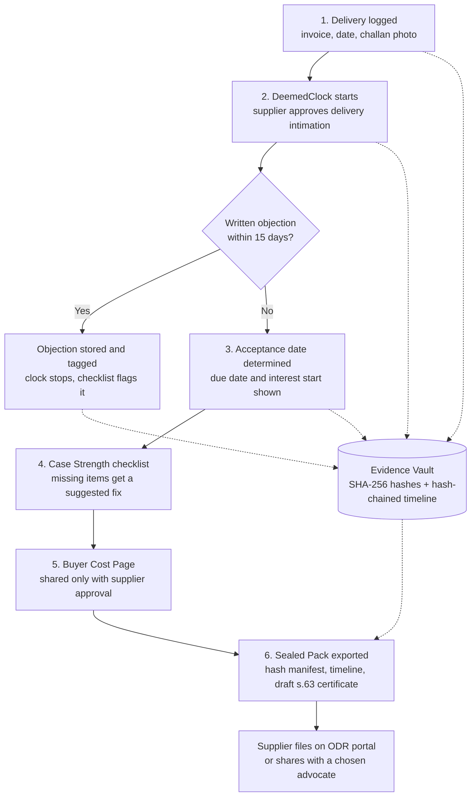
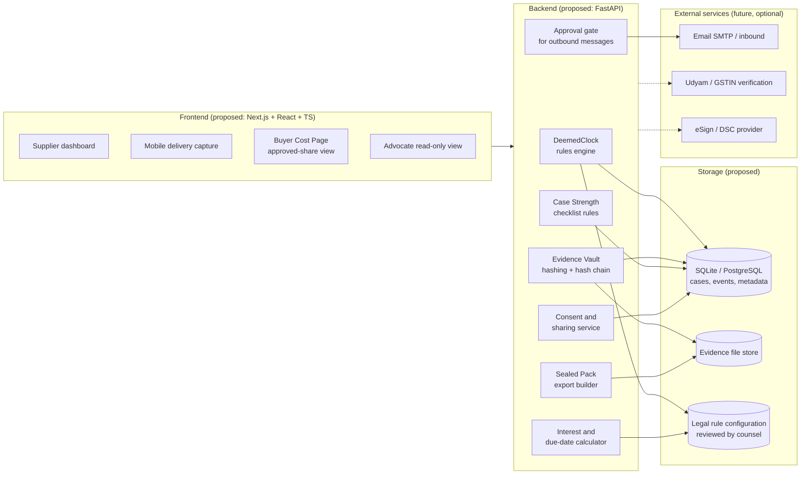

# PaySetu

**Evidence-first delayed-payment protection for Indian micro and small enterprises.**

PaySetu helps a micro or small supplier record and prove the date of acceptance. The MSMED Act's payment protections depend on that date. With it, the supplier can track statutory payment deadlines, preserve tamper-evident evidence and prepare a structured claim pack for legal review or dispute resolution.

> **Status:** Documentation-first planning phase. This repository has no application code yet. Everything in this README marked *proposed* or *planned* is a design intent, not something that has been built.
>
> **Not legal advice:** PaySetu prepares and organises evidence. It is not a law firm, collection agency, lawyer marketplace or official government filing portal. Every legal rule described here must be checked against official sources and reviewed by a qualified advocate before real-world use.

---

## Documentation Navigation

| Document | Location | Purpose |
| --- | --- | --- |
| README | [README.md](README.md) | Project overview (this file) |
| Agent rules | [AGENTS.md](AGENTS.md) | Mandatory rules for coding agents and contributors. **Read before changing anything** |
| Product requirements | [docs/PRD.md](docs/PRD.md) | Source of truth for scope, journeys, requirements and legal rules (tiers S, I and C) |
| Decision register | [docs/DECISIONS.md](docs/DECISIONS.md) | Architecture decisions (ADR-xxx) and legal review items (LR-xx), with status |
| Design system | [docs/DESIGN.md](docs/DESIGN.md) | Visual design, components, UX states and accessibility |
| Architecture | [docs/ARCHITECTURE.md](docs/ARCHITECTURE.md) | Tech stack, layers, security boundaries, deployment |
| Database | [docs/DATABASE.md](docs/DATABASE.md) | Data model, constraints, append-only triggers, backups |
| API | [docs/API.md](docs/API.md) | Endpoints, formats, errors, rate limits, integrations |
| Implementation plan | [docs/IMPLEMENTATION_PLAN.md](docs/IMPLEMENTATION_PLAN.md) | Phased build plan and the first milestone |

**Suggested reading order:**

- New contributors: README → PRD → DECISIONS → ARCHITECTURE.
- Coding agents: AGENTS → IMPLEMENTATION_PLAN → the documents their task touches.

**Precedence:** accepted entries in DECISIONS.md > PRD > ARCHITECTURE > DATABASE > API > DESIGN > this README.

---

## Table of Contents

1. [Project Overview](#1-project-overview)
2. [Problem Statement](#2-problem-statement)
3. [Why This Problem Matters](#3-why-this-problem-matters)
4. [Proposed Solution](#4-proposed-solution)
5. [Core Features and Modules](#5-core-features-and-modules)
6. [How PaySetu Works](#6-how-paysetu-works)
7. [Target Users](#7-target-users)
8. [Proposed Technology Stack](#8-proposed-technology-stack)
9. [System Architecture Overview](#9-system-architecture-overview)
10. [Project Folder Structure](#10-project-folder-structure)
11. [Development Roadmap](#11-development-roadmap)
12. [Current Implementation Status](#12-current-implementation-status)
13. [Installation and Local Development](#13-installation-and-local-development)
14. [Testing Strategy](#14-testing-strategy)
15. [Security, Privacy and Evidence Integrity](#15-security-privacy-and-evidence-integrity)
16. [Important Legal and Compliance Limitations](#16-important-legal-and-compliance-limitations)
17. [Future Enhancements](#17-future-enhancements)
18. [Glossary](#18-glossary)
19. [Team and Contributions](#19-team-and-contributions)
20. [License](#20-license)

---

## 1. Project Overview

| Item | Detail |
| --- | --- |
| Project name | PaySetu |
| Earlier working title | ProofFirst (used in the ideation document; module names are carried over) |
| Problem statement | LS-03: Paid on Time, by Law |
| Event / track | Srujana Tech Fest 2026, Legal Services track |
| Domain | LegalTech: MSME delayed-payment protection |
| Primary user | Udyam-registered micro and small suppliers in India |
| Source document | *LS03_Final_Ideathon_Document* (24 October 2026), based on ideation document v12 |

PaySetu works on the supplier's side, from delivery onwards. It records each delivery, opens a visible 15-day window in which the buyer can object, seals each piece of evidence with a SHA-256 hash and shows the due date and the interest owed. When a claim is needed, it exports a sealed evidence pack. The supplier can file that pack on the MSME ODR portal or share it with an advocate they choose.

PaySetu does not decide disputes. The ODR portal, the MSE Facilitation Council and the courts decide them. PaySetu's job is to make sure the supplier arrives with organised, verifiable evidence.

---

## 2. Problem Statement

The Micro, Small and Medium Enterprises Development (MSMED) Act, 2006 gives micro and small suppliers strong payment rights:

- payment within the agreed period, which can never be more than **45 days from the day of acceptance**
- **compound interest at three times the RBI bank rate**, with monthly rests, if the buyer pays late (s.16)
- access to a low-cost dispute process (the MSE Facilitation Council, and since 15 October 2025 the MSME ODR portal)

**Every one of these rights is counted from the day of acceptance.** Many small suppliers work informally: verbal orders, WhatsApp messages and loose delivery challans. They cannot reliably prove when goods were delivered or accepted. Many also do not know a key rule. If the buyer raises no written objection within 15 days of delivery, the delivery date is treated as the day of acceptance ("deemed acceptance"). This is the Explanation to s.2(b) of the MSMED Act; the wording was checked against the Act as enacted (PRD rule R3, tier S). How days are counted, and what counts as "in writing", are interpretations that still need an advocate's review (PRD Section 4.3).

Without that date, the supplier cannot work out the due date or the interest, and has little leverage to file a credible claim.

---

## 3. Why This Problem Matters

The figures below come from secondary sources cited in the ideation document. Verify them before using them in public material.

| Indicator | Figure | Source (as cited) and caution |
| --- | --- | --- |
| Money locked in delayed payments to MSMEs | Over Rs 10.7 lakh crore, nearly 6% of GVA | ICAI journal, citing an unnamed 2022 study |
| Share of MSME invoices paid late | About 80% | ICAI *Chartered Accountant* journal (secondary) |
| Pending Facilitation Council claims | 250,000+, under 10% resolved mutually | Mint, via c4scourses.in (Sept 2025) |
| ODR resolution pace (one state) | About 10.6% of 800+ Telangana cases resolved, Oct 2025 to Aug 2026 | YourStory (Sept 2026), one state only |
| Buyer power | Small suppliers accept long credit terms to keep customers | ICAI journal |

**Who counts as micro or small (from 1 April 2025, per the ideation document; thresholds are set by notification under s.7, which the 2026 Amendment re-enacted, so re-check them before quoting):**

| Class | Investment up to | Turnover up to |
| --- | --- | --- |
| Micro | Rs 2.5 crore | Rs 10 crore |
| Small | Rs 25 crore | Rs 100 crore |

Only micro and small enterprises with Udyam registration can use the delayed-payment protections in ss.15 to 24 (Chapter V) of the MSMED Act. Medium enterprises cannot.

### The gap

Existing tools each do one job:

| Category | Examples (named in research) | What is missing |
| --- | --- | --- |
| Delivery proof | WhatsApp ePOD tools (e.g. RichAutomate) | No link to the MSMED Act, no acceptance-clock logic, no sealing for evidence certificates |
| Payment reminders and receivables | Vyapar, TReDS platforms | No legal evidence layer; TReDS needs the buyer to be onboarded |
| Buyer-side compliance | Tally, Zoho | Built for buyers' MSME-1 and 43B(h) reporting, not for the supplier's proof |
| Notices and collections | Vasuli, Credgenics, law firms | No visible evidence or acceptance-clock features; lender-side or manual |
| Official dispute resolution | MSME ODR portal | Starts only at filing; does not build or grade evidence |

Among the tools reviewed, none turns delivery proof into evidence tied to the MSMED Act **before** a dispute starts. The review was not exhaustive.

---

## 4. Proposed Solution

PaySetu builds the evidence while the delivery happens, instead of rebuilding it once a dispute starts. Five gaps are mapped to five modules:

| # | Gap | PaySetu module |
| --- | --- | --- |
| G1 | Informal suppliers lack a provable date of acceptance and do not use the 15-day objection window | **DeemedClock** |
| G2 | Delivery proof is not turned into hash-sealed electronic evidence | **Evidence Vault** |
| G3 | Suppliers do not know what is missing from their file before filing | **Case Strength** |
| G4 | Buyers rarely see the cost of continued delay | **Buyer Cost Page** |
| G5 | No single pack works across the ODR portal, the Council and an advocate, with logged consent | **Sealed Pack** |

---

## 5. Core Features and Modules

### 5.1 DeemedClock (core module)

Tracks the date the whole claim depends on.

- Record delivery details: invoice, date, challan photo, delivery location. The requirement is 60 seconds or less on a phone; the ideation aspiration is about 20 seconds.
- Generate a buyer **delivery intimation** draft. It is sent only after the supplier approves it.
- Run a visible 15-day objection window from delivery.
- Record buyer replies and tag them as *objection*, *acknowledgement* or *other*.
- Work out the day of acceptance, the payment due date and the date interest starts from **configurable, legally reviewed rules**. The rules are not hard-coded legal conclusions.
- When the buyer raises a written objection, stop the clock and flag the objection for review.

> **Reading adopted (day counting is interpretation LR-01, counsel to confirm):** For a verbal deal where the buyer stays silent, the delivery day is the day of acceptance (statute text). Payment is due by Day 15 after delivery, and interest runs from Day 16, the "appointed day" under s.2(b). This replaces the "15 days after deemed acceptance" wording in ideation doc v12. See [PRD Section 4](docs/PRD.md#4-legal-rules-the-product-encodes) for every rule, its tier and a worked example.

### 5.2 Evidence Vault

Preserves evidence in a tamper-evident way.

- Store invoices, delivery challans, photographs, email records (`.eml`), chat exports and tracking records.
- Compute a **SHA-256** hash and capture a timestamp for each file when it is uploaded.
- Keep a **hash-chained audit timeline**: each event references the hash of the event before it.
- Detect changes to preserved evidence by re-hashing the files.
- Planned: grade inbound email by DKIM signature. Under consideration: RFC 3161 trusted timestamps.

### 5.3 Case Strength

A rule-based readiness checklist. It does not predict outcomes.

- Check for: Udyam registration, enterprise class, proof of delivery, intimation sent, objection status, written payment terms, invoice details, demand served, buyer acknowledgement, and the limitation window.
- Give each missing item a one-line suggested action.
- **Never** predict a tribunal or court outcome or guarantee recovery.

### 5.4 Buyer Cost Page

A buyer-facing summary, shared only when the supplier explicitly approves.

- Outstanding principal and an illustrative interest calculation to date.
- A plain-language explanation of the relevant provisions: s.16 interest, the s.19 pre-deposit of 75% of an award before a court challenge, and Income-tax Act s.43B(h). Each comes with a stated limitation.
- Shown to the buyer only through a link that the supplier has approved.

### 5.5 Sealed Pack

A structured export for the claim.

- Order proof, invoice details, delivery evidence and a chronological timeline.
- A hash manifest covering every included file.
- A **draft** certificate under Bharatiya Sakshya Adhiniyam (BSA) 2023 s.63, for review by a qualified person.
- A list of open questions for counsel.
- The supplier files the pack themselves, or shares it with an advocate they choose through a link that is consent-based, time-limited (proposed: 30 days), revocable and access-logged.

---

## 6. How PaySetu Works



### Example journey (illustrative)

Ravi runs a small fastener unit. He delivers goods worth Rs 5,00,000 on a verbal order.

1. **At the gate:** Ravi photographs the signed challan and enters the invoice.
2. **Intimation:** He approves a delivery intimation to the buyer's accounts team. The 15-day window is visible.
3. **Silence:** No written objection arrives. PaySetu shows the acceptance date and the due date under the configured rule.
4. **Missed payment:** PaySetu shows illustrative interest accrued. The checklist flags "demand served: missing".
5. **Demand:** Ravi reviews and approves a demand that links to the Buyer Cost Page.
6. **Still unpaid:** Ravi downloads the Sealed Pack. He files it on the ODR portal himself or shares it with an advocate he chooses.

---

## 7. Target Users

| User | Role in PaySetu |
| --- | --- |
| Micro and small suppliers (Udyam-registered) | Primary users: log deliveries, approve communications, export packs |
| Chartered accountants and accounting firms | Possible channel: help supplier clients keep records (hypothesis, not validated) |
| Advocates chosen by the supplier | Read-only access to a shared pack, with consent and time limits |
| Buyers' finance teams | Receive intimations and the Buyer Cost Page only when the supplier approves |

Possible distribution channels named in the ideation document are industry associations, CA firms, banks and MSME facilitation centres. None of these has been validated, and no pricing or demand data has been collected.

---

## 8. Proposed Technology Stack

> These are **proposed** technologies. None is installed or configured in this repository yet. The full stack, with reasoning (including SQLAlchemy, Alembic, Caddy and the toolchain versions), is in [docs/ARCHITECTURE.md Section 2](docs/ARCHITECTURE.md#2-recommended-tech-stack) and [docs/DECISIONS.md](docs/DECISIONS.md).

| Layer | Proposed technology | Purpose |
| --- | --- | --- |
| Frontend | Next.js, React, TypeScript | Supplier web app, mobile-friendly delivery capture |
| Styling | Tailwind CSS | UI styling |
| Backend | Python, FastAPI | REST API, rules engine, evidence processing |
| Database | SQLite (prototype); PostgreSQL (possible production upgrade) | Cases, deliveries, events, evidence metadata |
| Evidence integrity | SHA-256 (Python `hashlib`) | File hashing and hash-chained timeline |
| Documents | ReportLab | PDF generation (intimations, demand drafts, s.63 drafts, manifests) |
| Calculations | Python `decimal` | Exact interest and amount arithmetic, with no floating-point error |
| Backend testing | pytest | Unit and integration tests |
| End-to-end testing | Playwright | Browser-level workflow tests |
| Version control | Git and GitHub | Source control (the folder is not a Git repository yet) |

The ideation document also names pyHanko (PDF signing), DSC and Aadhaar eSign providers, email (SMTP and inbound webhooks), and optional WhatsApp intake. These are candidate integrations. None is part of the initial scope until it is confirmed.

---

## 9. System Architecture Overview



**Design principles:**

- **Rules as configuration.** Statutory periods, interest multipliers, RBI bank-rate history and the day-count method live in versioned configuration that counsel reviews. They are not scattered through the code.
- **Append-only evidence.** Evidence records and timeline events are never edited in place. A correction is a new event.
- **Human approval gate.** Nothing is sent to a buyer, and nothing is shared, without the supplier explicitly approving it.
- **Honest labelling.** Data from mock or sandbox integrations is labelled "simulated" and cannot be presented as live.

---

## 10. Project Folder Structure

**Current state (25 Oct 2026, after Phase 6):**

```
PaySetu/
├── README.md, AGENTS.md, CLAUDE.md, Makefile, .gitignore, .nvmrc
├── docs/                  # PRD, DECISIONS, DESIGN, ARCHITECTURE, DATABASE, API, IMPLEMENTATION_PLAN, HANDOVER, AUDIT_REPORT
├── backend/
│   ├── app/main.py        # app factory, /api/v1 prefix, middleware order
│   ├── app/api/deps.py    # session, clock and the supplier principal (auth dependency)
│   ├── app/api/v1/        # health, auth, supplier case routes (demo_cases.py)
│   ├── app/domain/        # pure legal and evidence engine (100% branch coverage)
│   ├── app/services/      # auth, cases, evidence pack
│   ├── app/security/      # CSRF, headers, body limit, rate limits, passwords, sessions
│   ├── app/models/, app/schemas/, app/repositories/, app/documents/, app/storage/, app/rules/
│   ├── alembic/versions/  # baseline, demo case core, accounts and ownership
│   ├── seed/              # demo.py (synthetic data), demo_account.py (demo login)
│   ├── tests/             # unit/ and integration/
│   └── requirements.txt, requirements-dev.txt, .env.example, pyproject.toml
└── frontend/
    ├── src/app/           # landing, (auth)/login and signup, app/ workspace, globals.css (tokens)
    ├── src/components/    # ui/, layout/, cases/
    ├── src/content/       # UI copy catalogue
    ├── src/lib/           # api/ (typed client), session/ (session guard), format/, hooks/
    ├── tests/e2e/         # Playwright specs against the real backend
    └── next.config.ts, playwright.config.ts, package.json
```

**Planned structure** (the files above exist; everything else is planned). The authoritative version is [docs/ARCHITECTURE.md Section 6](docs/ARCHITECTURE.md#6-folder-structure).

```
PaySetu/
├── README.md              # (exists)
├── AGENTS.md              # (exists)
├── docs/                  # (exists) detailed documentation
├── frontend/              # (planned) Next.js + React + TypeScript + Tailwind
│   ├── src/app/           # (planned) routes: (public), (app), b/[token], a/[token]
│   ├── src/components/    # (planned) ui/ primitives + domain components
│   ├── src/lib/           # (planned) api client, formatters, hooks
│   └── tests/e2e/         # (planned) Playwright
├── backend/               # (planned) FastAPI
│   ├── app/
│   │   ├── api/v1/        # (planned) routers
│   │   ├── services/      # (planned) use cases + transactions
│   │   ├── domain/        # (planned) pure logic: deemed_clock, interest, checklist, integrity
│   │   ├── rules/         # (planned) msmed-v1.toml
│   │   ├── repositories/ models/ schemas/ documents/ integrations/ storage/ security/
│   ├── alembic/           # (planned) migrations
│   ├── seed/              # (planned) bank rates, demo data
│   └── tests/             # (planned) unit, integration, legal fixtures
├── deploy/                # (planned) Caddyfile, systemd units
├── storage/               # (planned, gitignored) evidence, packs
└── Makefile               # (planned) dev, lint, typecheck, test, e2e, migrate, seed
```

---

## 11. Development Roadmap

Documentation (complete as draft v1.x) is followed by these build phases:

| Phase | Focus |
| --- | --- |
| 0 | Repository and tooling setup |
| 1 | Backend foundation (config, DB, errors, security middleware, storage) |
| 2 | Legal and integrity domain core (DeemedClock, interest, checklist, hash chain); pure logic |
| 3 | Authentication and supplier profile |
| 4 | Buyers, cases and timeline |
| 5 | Evidence Vault |
| 6 | Responses, payments, clock and interest API |
| 7 | Frontend foundation and design system |
| 8 | Frontend core case flows |
| 9 | Communications (intimation and demand) |
| 10 | Sealed Pack, share links, Buyer Cost Page, advocate view |
| 11 | Demo readiness, QA and hardening |
| 12 | Deployment, monitoring and final audit |
| 13 | P1 enhancements |

The task-level plan, with completion criteria and the first milestone, is in [docs/IMPLEMENTATION_PLAN.md](docs/IMPLEMENTATION_PLAN.md). MVP scope is defined in [docs/PRD.md Section 14](docs/PRD.md#14-mvp-scope-and-out-of-scope). Advocate review of the legal register runs in parallel and is required before any non-demo use.

---

## 12. Current Implementation Status

| Area | Status in this repository |
| --- | --- |
| Documentation | Complete set (README, AGENTS, PRD, DECISIONS, DESIGN, ARCHITECTURE, DATABASE, API, IMPLEMENTATION_PLAN) plus `docs/HANDOVER.md` (current state) and `docs/AUDIT_REPORT.md`. Open items are tracked in [docs/DECISIONS.md](docs/DECISIONS.md) |
| Frontend | Next.js 16.4.3 workspace in the "Oxford Blue + Stone" design system (Geist typeface; docs/DESIGN.md): landing page, sign-up and sign-in, dashboard, cases, Record delivery, and the case workspace (Overview with the DeemedClock timeline and **Download Evidence Pack**, Evidence Vault, Buyer responses, Case Strength, Interest, Timeline). The workspace requires a session; sign-out is in the sidebar and the mobile menu. Phase 6.1 adds forgot-password and reset-password pages and Account settings (change password, sign out everywhere) |
| Backend | FastAPI 0.162.0. Settings with a production gate, database and migrations, problem+json errors, JSON logs, injectable clock, CSRF, security headers, body limits and rate limits. Supplier routes for buyers, cases, buyer responses, evidence upload and download, integrity check, timeline, checklist, interest and the evidence-pack ZIP. **Phase 6:** signup, login, logout and me with Argon2id passwords and revocable server-side sessions; every supplier route requires a session and is scoped to the caller's supplier (another supplier's records answer 404). **Phase 6.1:** forgot and reset password (single-use 15-minute emailed link), change password, sign out everywhere; email through a development file outbox or SMTP. **Phase 7A:** email verification (built, then removed as an access requirement at the owner's request; signup and login open the dashboard directly; DECISIONS.md Section 12). **Phase 7B:** business onboarding (draft, Udyam number checks, private PDF certificate upload, immutable submission to Pending review, duplicate claims flagged for review); reviewer actions and any official verification are Phase 7C. Supplier routes are still mounted only outside production (legal review pending) |
| Database | SQLite via SQLAlchemy 2.1.6 and Alembic 1.20.1: baseline `bf48eb38df15`, demo case core `7f9909eb7e4c`, accounts and ownership `099b88746350` (users, sessions, `suppliers.owner_user_id`), password reset tokens `d71bd50903a9`, email verification `5c2e8a41f0b7`, business onboarding `8e1f3c9a2b64`. Append-only triggers on timeline events and evidence |
| Tests | Backend: 574 pytest tests (300 integration, 274 unit, including 24 counsel-readable legal fixtures); **100% line and branch coverage** of `backend/app/domain/` enforced by `make test`. Frontend: 28 Playwright tests × 2 viewports (360×800, 1280×800) = 56, against the real backend (nothing mocked). Results and caveats: [docs/HANDOVER.md](docs/HANDOVER.md) |
| External integrations (email, eSign, Udyam/GSTIN, WhatsApp) | Not started; none is live |
| Legal review of rules and templates | Not done. Interest defaults D3–D5 are owner-approved provisional simulation defaults only. The MSMED (Amendment) Act 2026 (Act 16 of 2026) was reviewed: it does not amend ss.2(b), 15 or 16, so no calculation changed. The enacted text and commencement notification still need Gazette confirmation and advocate review (LR-21, LR-23 to LR-25) |

**About earlier work:** The ideation document says that earlier prototype modules were built and passed 68 tests against local simulations. Those modules covered calculation, notice PDFs, signing, evidence hashing, postal parsing and advocate links. **That code is not in this workspace.** Its test results cannot be verified here, so this repository does not claim them. If the code is brought in later, this section will be updated.

---

## 13. Installation and Local Development

Every command below was run successfully on macOS (Apple Silicon) on 25 Oct 2026.

### Prerequisites

| Tool | Version | Notes |
| --- | --- | --- |
| Python | 3.12 (tested 3.12.13) | If `python3.12` is not on your PATH, pass its path: `make setup PYTHON=/path/to/python3.12` |
| Node.js | 22 LTS (tested 22.23.4); 20.9+ also allowed | `.nvmrc` pins 22, so `fnm` and `nvm` select it automatically |
| npm | Bundled with Node (tested 10.9.9) | |
| GNU Make | Any | All commands go through the root `Makefile` |

### First-time setup

```bash
make setup          # backend venv + pinned pip packages; frontend npm ci + Playwright Chromium
```

**Required:** create the backend configuration with `cp backend/.env.example backend/.env`. The API validates it at startup and refuses to start with a message naming any missing or invalid variable. The example values work for local development only. Optional: copy `frontend/.env.example` to `frontend/.env.local` to override the API proxy target.

Create the local database schema (SQLite file at `DATABASE_URL`, default `backend/storage/paysetu.db`):

```bash
make migrate         # alembic upgrade head, using DATABASE_URL from backend/.env
make migrate-status  # current revision and head revision
```

**Evaluation build (local only; do not enter real business or personal data):**

```bash
make migrate && make seed   # schema + one synthetic demo supplier, a sample buyer, one UNVERIFIED bank rate
DEMO_ACCOUNT_PASSWORD='choose-a-local-passphrase' make demo-account   # optional: a login for the demo supplier
make dev                    # API on :8000 and the web app on :3000 together
# open http://localhost:3000, then "Open demo workspace": sign in, or create an account
```

The demo account's email is `demo@paysetu.example` unless `DEMO_ACCOUNT_EMAIL` is set; the password is the one you passed and is never printed. A new account starts empty: add a buyer in the Record delivery form. Seeded demo data stays unreachable until `make demo-account` gives it a login.

Auth endpoints: `POST /auth/signup`, `POST /auth/login`, `POST /auth/logout`, `GET /auth/me` (session cookie `ps_session`, HttpOnly); Phase 6.1 adds `POST /auth/forgot-password`, `POST /auth/reset-password`, `POST /auth/change-password` and `POST /auth/logout-all`. Case-workspace endpoints need a session; email verification is not required. Business onboarding (Phase 7B): `GET /onboarding`, `PUT /onboarding/draft`, `POST /onboarding/certificate`, `GET /onboarding/certificates/{id}/download`, `POST /onboarding/submit`, `GET /onboarding/submissions` (email-verified suppliers; nothing is ever verified automatically). Supplier endpoints (session required, scoped to the signed-in supplier): `GET /supplier`, `GET|POST /buyers`, `GET|POST /cases`, `GET /cases/{id}`, `/cases/{id}/checklist`, `/cases/{id}/interest`, `GET|POST /cases/{id}/responses`, `POST /cases/{id}/responses/{rid}/remove-objection`, `GET|POST /cases/{id}/evidence`, `GET /evidence/{id}/download`, `POST /cases/{id}/integrity-check`, `GET /cases/{id}/timeline`. `GET /cases/{id}/evidence-pack` downloads a ZIP (summary, DeemedClock and interest, timeline, checklist, verification report, original evidence, SHA-256 manifest); it is refused if integrity verification fails and carries no Section 63 certificate. Writes need `Origin: http://localhost:3000` and `X-PaySetu-Client: web` (CSRF). Deviations are listed in [docs/DECISIONS.md Section 7](docs/DECISIONS.md#7-hackathon-demo-vertical-slice-25-oct-2026-owner-directed).

Other migration commands, run from `backend/`:

```bash
.venv/bin/alembic revision -m "short description"   # new empty migration (hand-write it; see DATABASE.md Section 8)
.venv/bin/alembic downgrade -1                       # step back one revision (development only)
.venv/bin/alembic upgrade head --sql                 # print the SQL without touching a database
```

### Local email testing (password reset)

With `EMAIL_MODE=simulated` (the default in `backend/.env.example`) nothing is sent. Every email is written as an `.eml` file to `STORAGE_DIR/outbox/` (default `backend/storage/outbox/`).

**Email verification** is no longer required (DECISIONS.md Section 12): signup and login open the dashboard directly.

**Reset a password.**

1. Open http://localhost:3000/login, choose **Forgot password?** and enter the account's email.
2. Run `make email-outbox`. It lists the newest messages and prints the newest one, including the reset link (`http://localhost:3000/reset-password#token=…`). It refuses to run with `APP_ENV=production`.
3. Open the link within 15 minutes and choose a new password. Every device is signed out; sign in again. A "password changed" notice appears in the outbox.

To send real email, set `EMAIL_MODE=smtp` with `SMTP_HOST`, `SMTP_PORT`, `SMTP_STARTTLS`, `EMAIL_FROM` and, if the provider needs them, `SMTP_USERNAME` and `SMTP_PASSWORD` in `backend/.env` (never commit them).

### Business onboarding (Phase 7B)

Sign in with a verified account and open **Business profile** in the sidebar (`/app/onboarding`). Fill in the details (the Udyam number is accepted in any spacing or case and saved as `UDYAM-XX-00-0000000`), upload the certificate PDF (up to 5 MB, `BUSINESS_CERTIFICATE_MAX_MB`), **Save draft**, then **Review & submit**. The status becomes **Pending review** and the details are locked. Nothing is verified automatically and no official Udyam check is made; reviewer actions arrive in Phase 7C. Certificates are stored privately under `STORAGE_DIR/business/`, separate from case evidence, and download only to their owner. The case workspace does not depend on this status.

### Run the apps

```bash
make dev-api        # FastAPI on http://localhost:8000  (health: /api/v1/health, docs: /api/v1/docs)
make dev-web        # Next.js on http://localhost:3000  (proxies /api/* to port 8000)
make dev            # both together
```

The two apps run independently. The frontend does not need the API to render the landing page.

### Checks

```bash
make lint           # ruff check + ruff format --check; eslint + prettier --check
make typecheck      # mypy (strict) on backend/app and backend/tests; next typegen + tsc --noEmit
make test           # pytest + 100% branch-coverage gate on backend/app/domain
make build          # next build (production)
make e2e            # Playwright journeys at 360×800 and 1280×800 against a fresh real backend (needs `make setup`)
make api-types      # regenerate frontend API types after any backend API change
make help           # list all targets
```

---

## 14. Testing Strategy

| Level | Tool (proposed) | Focus |
| --- | --- | --- |
| Unit | pytest | Date arithmetic for the acceptance window and due dates, interest calculation (monthly compounding, rate periods, day-count), hashing, checklist rules |
| Integration | pytest + FastAPI test client | API flows: create case, record delivery, record objection, export pack |
| End-to-end | Playwright | Full supplier journey from delivery capture to Sealed Pack export |
| Integrity | pytest | Tampering with a sealed file or timeline entry must be detected |
| Rule fixtures | pytest | Worked examples reviewed by counsel, kept as regression fixtures |

Testing principles:

- Use exact `Decimal` arithmetic and test boundary dates explicitly: day 15 against day 16, month ends, leap years and changes in the RBI rate.
- Every legal rule should have at least one worked example that counsel has reviewed before it is treated as correct.
- Tests that use mocked external services must be labelled as simulated.
- Test fixtures must never contain real supplier, buyer or personal data.

---

## 15. Security, Privacy and Evidence Integrity

**Evidence integrity**

- A SHA-256 hash is computed for every file when it is uploaded and recorded in the timeline.
- Timeline events are hash-chained, so a change to any earlier entry can be detected.
- Exports include a hash manifest, so any recipient can check the files independently.
- **Limitation:** a hash proves that a file has not changed since it was hashed. It does not prove that the file was genuine when it was uploaded, and it does not by itself make the file admissible. Admissibility depends on a proper BSA s.63 certificate, a chain of custody and the judgement of the forum.

**Consent and approval**

- No intimation, demand or Buyer Cost Page reaches a buyer without the supplier's explicit approval.
- Nothing is sent in the supplier's name without proper authority, such as a Letter of Authority.
- Advocate access is chosen by the supplier, time-limited, revocable and access-logged.
- Signatory identity, capacity and authority are recorded for any signed document. Aadhaar eSign signs as an individual, not as a company.

**Data protection**

- Consent, purpose limitation, retention and deletion under the Digital Personal Data Protection (DPDP) Act, 2023 must be built in before any real use.
- Secrets such as API keys and SMTP credentials go in environment variables and are never committed. A `.env.example` file will list variable names only.
- Data from mock or sandbox integrations is labelled "simulated" and cannot pass a production readiness check.

---

## 16. Important Legal and Compliance Limitations

PaySetu is a tool for preparing evidence. Users and contributors should understand the following:

1. **Not legal advice.** Nothing PaySetu produces is legal advice. Calculations, checklists, notices and certificates are drafts for the supplier and qualified counsel to review.
2. **No guarantee of recovery.** PaySetu does not predict outcomes and does not promise payment or recovery.
3. **Statutory rules need review.** The wording of s.2(b), s.15, s.16 and s.19 was checked against the Act as enacted, but not against later amendments. Several readings the product relies on are interpretations, not settled law: day counting (Day 15 / Day 16), what counts as "in writing" and the limitation period (generally three years). An advocate must confirm them (see the legal register in [docs/DECISIONS.md](docs/DECISIONS.md) and [docs/PRD.md Section 17](docs/PRD.md#17-open-legal-questions-for-counsel)).
   - Udyam registration dated after the supply may limit a claim.
   - Trading-only registrations may not be covered.

   The checklist flags both.
4. **Interest figures are illustrative.** The ideation document records the RBI Bank Rate as 5.75% from 7 October 2026, which makes 3x equal to 17.25% a year. Real claims must use the official rate notified for each period. The day-count method (days/365 is proposed) must be confirmed by counsel.
5. **Forum procedures change.** Details of the MSME ODR portal and its required document list have not been verified, because access to the portal was blocked during research. Check the official portal before relying on any export format.
6. **Tax references need checking.** Income-tax Act 1961 s.43B(h) is referenced. How it is numbered under the Income-tax Act 2025 still needs to be verified.
7. **Professional conduct.** PaySetu does not rank, refer or take fees from advocates. Revenue, if any, would come only from suppliers or accountants. Whether the advocate-sharing design is compatible with Bar Council of India Rule 36 needs a legal opinion.
8. **Eligibility.** Only Udyam-registered micro and small enterprises can use the ss.15 to 24 protections. PaySetu should check eligibility and must not assume it.
9. **Not an official portal.** PaySetu is not affiliated with the Ministry of MSME, the ODR portal or any Facilitation Council.

---

## 17. Future Enhancements

- WhatsApp-based delivery capture (a stretch goal in the ideation document)
- Live Udyam and GSTIN verification through a provider API
- Live eSign or DSC signing of approved documents
- RFC 3161 trusted timestamping for evidence
- DKIM verification and grading of inbound buyer emails
- Parsing of postal tracking evidence (India Post's real format is not yet known)
- Multilingual interface for regional-language suppliers
- Integration with accounting software used by suppliers and CAs
- A PostgreSQL production deployment with backups and audit retention
- An export layout matched to the official ODR portal document list, once that list is confirmed

---

## 18. Glossary

| Term | Plain meaning |
| --- | --- |
| MSMED Act 2006 | The law protecting micro, small and medium enterprises, including their payment rights |
| Udyam registration | The government registration that classifies a business as micro, small or medium |
| Day of acceptance | The day the buyer is treated as having accepted goods or services; deadlines count from it |
| Deemed acceptance | If the buyer raises no written objection within 15 days, the delivery day counts as acceptance (MSMED Act s.2(b), Explanation (ii)) |
| RBI bank rate | The rate notified by the Reserve Bank of India; used to compute s.16 interest |
| MSE Facilitation Council | The state body that conciliates and then arbitrates delayed-payment claims |
| ODR portal | The government's online dispute resolution portal for MSME payment claims |
| s.43B(h) | Income-tax rule that delays a buyer's deduction for overdue MSME dues until they are paid |
| BSA s.63 certificate | The certificate the Bharatiya Sakshya Adhiniyam 2023 requires for electronic evidence |
| SHA-256 hash | A fixed-length fingerprint of a file; changing any bit changes it completely |
| DKIM | An email signature that shows a message really came from the sender's domain |
| TReDS | Platforms where MSMEs sell invoices to financiers at a discount |
| DPDP Act 2023 | India's Digital Personal Data Protection Act |

---


Contribution rules (code quality, security, testing, branching and commit conventions) are in [AGENTS.md](AGENTS.md). The repository is not yet initialised with Git (task T0.1 in [docs/IMPLEMENTATION_PLAN.md](docs/IMPLEMENTATION_PLAN.md)).

---

## 20. License

**Undecided.** No license has been chosen yet, and no `LICENSE` file exists. Until one is added, all rights are reserved by the project authors.
