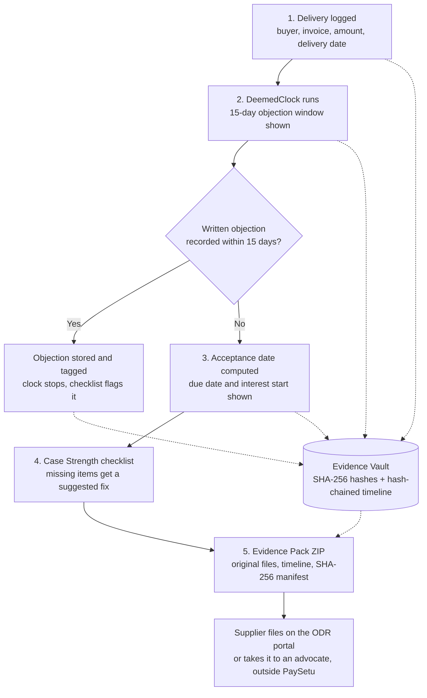
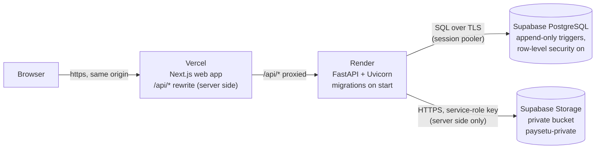

# PaySetu

## 🚀 Live Demo — PaySetu

Live Application: https://srujana-hackathon2026-pay-setu.vercel.app

Backend API: https://srujana-hackathon2026-paysetu.onrender.com

Backend Health Check: https://srujana-hackathon2026-paysetu.onrender.com/api/v1/health

PaySetu is a LegalTech prototype designed to help Indian Micro and Small Enterprises understand delayed-payment deadlines, organize evidence, estimate statutory interest, and prepare structured evidence packs under the MSMED Act, 2006.

**Deployment Stack:** Vercel (Next.js frontend), Render (FastAPI backend), Supabase (PostgreSQL and private document storage).

*Note: The backend runs on Render's free tier and may take additional time to respond after a period of inactivity. This is a demonstration prototype, not legal advice.*

**Evidence-first delayed-payment protection for Indian micro and small enterprises.**

PaySetu helps a micro or small supplier record and prove the date of acceptance. The MSMED Act's payment protections depend on that date. With it, the supplier can track statutory payment deadlines, preserve tamper-evident evidence and export a structured evidence pack for legal review or dispute resolution.

## Live demo

| | URL |
| --- | --- |
| Web app (Vercel) | https://srujana-hackathon2026-pay-setu.vercel.app |
| API (Render) | https://srujana-hackathon2026-paysetu.onrender.com |
| API health check | https://srujana-hackathon2026-paysetu.onrender.com/api/v1/health (returns `{"status":"ok"}`) |

**Try it:** open the web app, choose **Create account**, then **Record delivery** (use a delivery date about 20 days ago and add a buyer inline). The case page shows the DeemedClock dates, the interest calculation and the Evidence Vault; upload a file, run **Verify integrity** and **Download Evidence Pack**. **Business profile** in the sidebar takes you through Udyam certificate onboarding.

> **Before you try the live demo**
>
> - **Use synthetic data only.** This is a hackathon evaluation build. Do not enter real business, personal or financial data.
> - **The API sleeps when idle.** It runs on Render's free plan: the first request after about 15 idle minutes can take about 50 seconds. Open the health check URL first if the app seems slow.
> - **Known issue at the time of writing (26 Oct 2026):** the web app's `/api/*` proxy answered 404 while the API itself was healthy. Sign-in on the live site works only once `API_ORIGIN` is set in the Vercel project and the frontend is rebuilt ([Section 15](#15-deployment)).
>
> **Not legal advice.** PaySetu prepares and organises evidence. It is not a law firm, collection agency, lawyer marketplace or official government filing portal. Every legal rule described here must be checked against official sources and reviewed by a qualified advocate before real-world use.

---

## Documentation Navigation

| Document | Location | Purpose |
| --- | --- | --- |
| README | [README.md](README.md) | Project overview (this file) |
| Agent rules | [AGENTS.md](AGENTS.md) | Mandatory rules for coding agents and contributors. **Read before changing anything** |
| Product requirements | [docs/PRD.md](docs/PRD.md) | Scope, journeys, requirements and legal rules (tiers S, I and C) |
| Decision register | [docs/DECISIONS.md](docs/DECISIONS.md) | Architecture decisions (ADR-xxx), legal review items (LR-xx) and per-phase decisions, with status |
| Handover | [docs/HANDOVER.md](docs/HANDOVER.md) | Current state, test results, known issues and next tasks |
| Design system | [docs/DESIGN.md](docs/DESIGN.md) | Visual design ("Warm Ledger"), light and dark themes, components, accessibility |
| Architecture | [docs/ARCHITECTURE.md](docs/ARCHITECTURE.md) | Stack, layers, security boundaries, environment variables |
| Database | [docs/DATABASE.md](docs/DATABASE.md) | Data model, constraints, append-only triggers |
| API | [docs/API.md](docs/API.md) | Endpoints, formats, errors, rate limits |
| Implementation plan | [docs/IMPLEMENTATION_PLAN.md](docs/IMPLEMENTATION_PLAN.md) | The original phased build plan |
| Audit report | [docs/AUDIT_REPORT.md](docs/AUDIT_REPORT.md) | Earlier code and documentation audit |

**Precedence:** accepted entries in DECISIONS.md > PRD > ARCHITECTURE > DATABASE > API > DESIGN > this README.

---

## Table of Contents

1. [Project Overview](#1-project-overview)
2. [Problem Statement](#2-problem-statement)
3. [Why This Problem Matters](#3-why-this-problem-matters)
4. [Solution and Modules](#4-solution-and-modules)
5. [Feature Status](#5-feature-status)
6. [How PaySetu Works](#6-how-paysetu-works)
7. [Target Users](#7-target-users)
8. [Technology Stack](#8-technology-stack)
9. [Deployment Architecture](#9-deployment-architecture)
10. [Project Folder Structure](#10-project-folder-structure)
11. [Database and Migrations](#11-database-and-migrations)
12. [API Overview](#12-api-overview)
13. [Development Phases](#13-development-phases)
14. [Installation and Local Development](#14-installation-and-local-development)
15. [Deployment](#15-deployment)
16. [Testing](#16-testing)
17. [Security, Privacy and Evidence Integrity](#17-security-privacy-and-evidence-integrity)
18. [Important Legal and Compliance Limitations](#18-important-legal-and-compliance-limitations)
19. [Known Demo Limitations](#19-known-demo-limitations)
20. [Future Enhancements](#20-future-enhancements)
21. [Glossary](#21-glossary)
22. [Team and Contributions](#22-team-and-contributions)
23. [License](#23-license)

---

## 1. Project Overview

| Item | Detail |
| --- | --- |
| Project name | PaySetu |
| Earlier working title | ProofFirst (used in the ideation document; module names are carried over) |
| Problem statement | LS-03: Paid on Time, by Law |
| Event / track | Srujana Tech Fest 2026, Legal Services track |
| Domain | LegalTech: MSME delayed-payment protection |
| Primary user | Udyam-registered micro and small suppliers in India |
| Source document | *LS03_Final_Ideathon_Document* (24 October 2026), based on ideation document v12 |
| Status | Working evaluation build, deployed on Vercel (web), Render (API) and Supabase (PostgreSQL and private file storage) |

PaySetu works on the supplier's side, from delivery onwards. In the current build a supplier records a delivery and the buyer's responses; PaySetu computes the 15-day objection window, the day of acceptance, the payment due date and illustrative interest from a versioned rule set, seals each uploaded evidence file with a SHA-256 hash, keeps a hash-chained case timeline, shows a readiness checklist and exports an Evidence Pack ZIP with a hash manifest. Suppliers can also submit their Udyam details and certificate for a **manual** review by a PaySetu reviewer.

PaySetu does not decide disputes. The ODR portal, the MSE Facilitation Council and the courts decide them. PaySetu's job is to help the supplier arrive with organised, verifiable evidence.

---

## 2. Problem Statement

The Micro, Small and Medium Enterprises Development (MSMED) Act, 2006 gives micro and small suppliers strong payment rights:

- payment within the agreed period, which can never be more than **45 days from the day of acceptance**
- **compound interest at three times the RBI bank rate**, with monthly rests, if the buyer pays late (s.16)
- access to a low-cost dispute process (the MSE Facilitation Council, and since 15 October 2025 the MSME ODR portal)

**Every one of these rights is counted from the day of acceptance.** Many small suppliers work informally: verbal orders, WhatsApp messages and loose delivery challans. They cannot reliably prove when goods were delivered or accepted. Many also do not know a key rule. If the buyer raises no written objection within 15 days of delivery, the delivery date is treated as the day of acceptance ("deemed acceptance"). This is the Explanation to s.2(b) of the MSMED Act; the wording was checked against the Act as enacted (PRD rule R3, tier S). How days are counted, and what counts as "in writing", are interpretations that still need an advocate's review (PRD Section 4.3).

Without that date, the supplier cannot work out the due date or the interest, and has little leverage to file a credible claim.

---

## 3. Why This Problem Matters

The figures below come from secondary sources cited in the ideation document. Verify them before using them in public material.

| Indicator | Figure | Source (as cited) and caution |
| --- | --- | --- |
| Money locked in delayed payments to MSMEs | Over Rs 10.7 lakh crore, nearly 6% of GVA | ICAI journal, citing an unnamed 2022 study |
| Share of MSME invoices paid late | About 80% | ICAI *Chartered Accountant* journal (secondary) |
| Pending Facilitation Council claims | 250,000+, under 10% resolved mutually | Mint, via c4scourses.in (Sept 2025) |
| ODR resolution pace (one state) | About 10.6% of 800+ Telangana cases resolved, Oct 2025 to Aug 2026 | YourStory (Sept 2026), one state only |
| Buyer power | Small suppliers accept long credit terms to keep customers | ICAI journal |

**Who counts as micro or small (from 1 April 2025, per the ideation document; thresholds are set by notification under s.7, which the 2026 Amendment re-enacted, so re-check them before quoting):**

| Class | Investment up to | Turnover up to |
| --- | --- | --- |
| Micro | Rs 2.5 crore | Rs 10 crore |
| Small | Rs 25 crore | Rs 100 crore |

Only micro and small enterprises with Udyam registration can use the delayed-payment protections in ss.15 to 24 (Chapter V) of the MSMED Act. Medium enterprises cannot.

### The gap

Existing tools each do one job:

| Category | Examples (named in research) | What is missing |
| --- | --- | --- |
| Delivery proof | WhatsApp ePOD tools (e.g. RichAutomate) | No link to the MSMED Act, no acceptance-clock logic, no sealing for evidence certificates |
| Payment reminders and receivables | Vyapar, TReDS platforms | No legal evidence layer; TReDS needs the buyer to be onboarded |
| Buyer-side compliance | Tally, Zoho | Built for buyers' MSME-1 and 43B(h) reporting, not for the supplier's proof |
| Notices and collections | Vasuli, Credgenics, law firms | No visible evidence or acceptance-clock features; lender-side or manual |
| Official dispute resolution | MSME ODR portal | Starts only at filing; does not build or grade evidence |

Among the tools reviewed, none turns delivery proof into evidence tied to the MSMED Act **before** a dispute starts. The review was not exhaustive.

---

## 4. Solution and Modules

PaySetu builds the evidence while the delivery happens, instead of rebuilding it once a dispute starts. The design maps five gaps to five modules; three are built, one is built in a reduced form, and one is not built yet.

| # | Gap | Module | Status |
| --- | --- | --- | --- |
| G1 | Informal suppliers lack a provable date of acceptance and do not use the 15-day objection window | **DeemedClock** | Built (no buyer intimation is sent; see [Section 5](#5-feature-status)) |
| G2 | Delivery proof is not turned into hash-sealed electronic evidence | **Evidence Vault** | Built |
| G3 | Suppliers do not know what is missing from their file before filing | **Case Strength** | Built |
| G4 | Buyers rarely see the cost of continued delay | **Buyer Cost Page** | Not built |
| G5 | No single pack works across the ODR portal, the Council and an advocate, with logged consent | **Sealed Pack** | Partly built as the **Evidence Pack** ZIP download; no share links, no advocate view, no s.63 certificate |

> **Reading adopted (day counting is interpretation LR-01, counsel to confirm):** For a verbal deal where the buyer stays silent, the delivery day is the day of acceptance (statute text). Payment is due by Day 15 after delivery, and interest runs from Day 16, the "appointed day" under s.2(b). This replaces the "15 days after deemed acceptance" wording in ideation doc v12. See [PRD Section 4](docs/PRD.md#4-legal-rules-the-product-encodes) for every rule, its tier and a worked example.

---

## 5. Feature Status

Status is taken from the source code and tests in this repository, not from the plan.

### 5.1 Implemented

| Area | What works | Where |
| --- | --- | --- |
| **Accounts and sessions** | Signup (creates the user, their supplier and a session), login, logout, sign out everywhere, forgot and reset password (single-use 15-minute link), change password, Account settings. Argon2id password hashes; server-side sessions stored as SHA-256 hashes in an HttpOnly, SameSite=Lax cookie (`Secure` on https); CSRF checks on every write; per-IP and per-account rate limits. Email verification is not required (it was built, then removed at the owner's request; DECISIONS.md Section 12) | `backend/app/services/auth.py`, `app/security/`, `frontend/src/app/(auth)/` |
| **Ownership** | Every supplier query is scoped to the signed-in supplier; another supplier's records answer 404 | `backend/tests/integration/test_authorisation.py` |
| **Cases and DeemedClock** | Record a delivery (buyer, invoice, amount, dates, deal type), record buyer responses (objection, acknowledgement, other) and remove an objection. The 15-day objection window, day of acceptance, due date, interest start date and next action are **computed** from the rule set `backend/app/rules/msmed-v1.toml` (rule IDs R1–R5 and others), never stored | `backend/app/domain/deemed_clock.py`, `app/services/cases.py` |
| **Interest calculator** | Compound interest with monthly rests at three times the bank rate, exact `Decimal` arithmetic, assumptions shown (provisional defaults D3–D5, see [Section 18](#18-important-legal-and-compliance-limitations)) | `backend/app/domain/interest.py` |
| **Evidence Vault** | Upload PDF, JPEG, PNG, HEIC, `.eml` and UTF-8 text (type checked by magic bytes; 15 MB limit); SHA-256 computed on the server over the original bytes; content-addressed, never overwritten; download as an attachment; **Verify integrity** re-hashes every file and re-walks the hash-chained timeline | `backend/app/storage/evidence_store.py`, `app/domain/integrity.py` |
| **Case timeline** | Append-only, hash-chained events for every case action | `backend/app/domain/integrity.py` |
| **Case Strength** | Rule-based readiness checklist with a one-line suggested action per missing item; never predicts outcomes | `backend/app/domain/checklist.py` |
| **Evidence Pack** | ZIP download: case summary, DeemedClock and interest, timeline (Markdown and JSON), checklist, verification report, the original evidence files unchanged and `manifest.json` with a SHA-256 for every file. Refused if any file or the timeline fails verification | `backend/app/services/pack.py`, `app/documents/pack.py` |
| **Business onboarding** | Supplier enters enterprise details and uploads the Udyam certificate PDF (structural PDF checks, active content refused, 5 MB limit); Udyam numbers are normalised to `UDYAM-XX-00-0000000` and format-checked; draft, review and submit; each submission is an immutable snapshot with its own SHA-256; duplicate Udyam numbers across accounts are flagged as contested claims | `backend/app/services/onboarding.py`, `frontend/src/app/app/onboarding/` |
| **Manual reviewer workflow** | Reviewer role granted only with the operator CLI (`make reviewer`); review queue; submission detail with snapshot and certificate integrity; certificate download; manual checks that record the source consulted, what was compared, the result and the date; decisions (approve, reject, request information) with reasons; final, append-only review history; resubmission after a request for information; self-review is refused | `backend/app/services/review.py`, `tools/reviewer.py`, `frontend/src/app/app/review/` |
| **Interface** | Responsive web app (tested at 360×800 and 1280×800), light, dark and system themes, loading, empty and error states | `frontend/src/` |
| **Hosted deployment** | Next.js on Vercel, FastAPI on Render, PostgreSQL on Supabase, uploaded files in a private Supabase Storage bucket reached only from the server | `render.yaml`, [Section 9](#9-deployment-architecture) |

### 5.2 Simulated or demo-only

| Item | What is real and what is not |
| --- | --- |
| Email | `EMAIL_MODE=simulated` writes each message to a local outbox file instead of sending it. The hosted demo runs in this mode, so **password-reset emails are not delivered** there. An SMTP sender exists in the code (`EMAIL_MODE=smtp`) but is not configured in the deployment |
| Bank rate | The only rate on record is an **unverified** 5.75% from 7 Oct 2026 (from the ideation document), inserted by the demo seed and labelled unverified in the UI. Without the seed, interest reports "rate data unavailable" |
| Demo data | `make seed` creates one synthetic supplier, one sample buyer and the unverified rate; `make demo-account` gives that supplier a login |
| Udyam details | Everything a supplier submits is self-declared. A reviewer's approval records that a person checked it by hand; it is **not** a government verification |

### 5.3 Partially implemented

| Item | Built | Not built |
| --- | --- | --- |
| Sealed Pack | Evidence Pack ZIP with hash manifest | Persistent sealed packs, share links, advocate view, BSA s.63 certificate draft |
| DeemedClock | Clock, responses, objections | Buyer delivery intimation and demand letters (C11 and C13 in the checklist always show as missing) |
| Payments | Interest computed on the full invoice amount | Recording part payments (the paid amount is zero) |
| Udyam verification | Format checks, certificate storage, manual review | Any official Udyam lookup or provider API |
| Eligibility | Shown from the supplier profile (self-declared) | Using an approved business profile to update eligibility |

### 5.4 Not built (future)

Buyer Cost Page; outbound communications (intimations, demands) with an approval gate; share links and an advocate read-only view; BSA s.63 certificate drafts; eSign or DSC signing; official Udyam or GSTIN verification; WhatsApp intake; DKIM grading of emails; RFC 3161 timestamps; account deletion. See [Section 20](#20-future-enhancements).

---

## 6. How PaySetu Works



Not shown because not built: buyer intimations and demands, the Buyer Cost Page and in-app sharing with an advocate.

### Example journey (illustrative)

Ravi runs a small fastener unit. He delivers goods worth Rs 5,00,000 on a verbal order.

1. **Record delivery:** Ravi enters the invoice and delivery date and uploads the signed challan photo. Its SHA-256 is recorded.
2. **Window:** the 15-day objection window is visible on the case page.
3. **Silence:** no written objection is recorded. PaySetu shows the acceptance date and the due date under the configured rule.
4. **Missed payment:** PaySetu shows illustrative interest accrued and what is still missing from the file.
5. **Still unpaid:** Ravi verifies integrity and downloads the Evidence Pack. He files it on the ODR portal himself or takes it to an advocate he chooses.

---

## 7. Target Users

| User | Role in PaySetu |
| --- | --- |
| Micro and small suppliers (Udyam-registered) | Primary users: record deliveries and responses, keep evidence, export the Evidence Pack, submit business details for review |
| PaySetu reviewers (staff) | Manually review submitted business details and certificates; accounts are created only by an operator |
| Chartered accountants and accounting firms | Possible channel: help supplier clients keep records (hypothesis, not validated) |
| Advocates chosen by the supplier | Receive the exported pack from the supplier (in-app sharing is not built) |
| Buyers' finance teams | Planned recipients of intimations and the Buyer Cost Page (not built) |

Possible distribution channels named in the ideation document are industry associations, CA firms, banks and MSME facilitation centres. None of these has been validated, and no pricing or demand data has been collected.

---

## 8. Technology Stack

Versions are the exact pins in `frontend/package.json` and `backend/requirements.txt`.

| Layer | Technology | Purpose |
| --- | --- | --- |
| Frontend | Next.js 16.4.3, React 19.3.0, TypeScript 5.9.3 | Supplier and reviewer web app |
| Styling | Tailwind CSS 4.3.3, Geist typeface | "Warm Ledger" design system with light and dark themes (docs/DESIGN.md) |
| API types | openapi-typescript 7.13.0 | Frontend types generated from the backend OpenAPI schema |
| Backend | Python 3.12, FastAPI 0.162.0, Uvicorn 0.54.0, pydantic-settings 2.16.1 | REST API, rules engine, evidence processing |
| Database access | SQLAlchemy 2.1.6, Alembic 1.20.1 | Models and migrations |
| Databases | SQLite (local development and tests); PostgreSQL via psycopg 3.3.6 (hosted, on Supabase) | Cases, evidence metadata, timeline, accounts, reviews |
| File storage | Local disk (development); private Supabase Storage bucket (hosted), over HTTPS with Python's standard library | Original evidence files and certificates |
| Passwords | argon2-cffi 25.1.0 (Argon2id) | Password hashing |
| Evidence integrity | SHA-256 (Python `hashlib`) | File hashes, hash-chained timeline, snapshot hashes |
| Calculations | Python `decimal` | Exact interest arithmetic |
| Exports | Python `zipfile`, Markdown and JSON | Evidence Pack (no PDF generation library is used) |
| Testing | pytest, pytest-cov, Playwright 1.64.1 | Unit, integration and browser tests |
| Code quality | Ruff, mypy (strict on `app/domain`), ESLint 9, Prettier 3 | Lint, format, type checks |
| Hosting | Vercel (web), Render Free (API), Supabase Free (PostgreSQL and Storage) | Public deployment |

---

## 9. Deployment Architecture



- **One origin for the browser.** The browser only talks to the Vercel site; Next.js rewrites `/api/*` to the Render API (`API_ORIGIN`). The session cookie therefore belongs to the Vercel domain and is `Secure`, HttpOnly and SameSite=Lax.
- **Startup migrations.** Render runs `alembic upgrade head` before starting Uvicorn on `$PORT` (`render.yaml`).
- **Private files.** Evidence and certificates are stored in a private bucket and reach users only through PaySetu's authenticated, owner-checked download routes. The Supabase service-role key exists only in Render's environment.
- **Database hardening.** On PostgreSQL, migration `6b0d2f4a8c31` creates the append-only triggers (the SQLite equivalents already existed) and enables row-level security on every table, with no policies, so Supabase's public REST roles cannot read PaySetu's tables.
- **Evaluation mode.** The hosted API runs with `APP_ENV=development`, because the case, onboarding and review routes are mounted only outside `production` while the legal rules await review (DECISIONS.md Section 7). The https origin, a generated `TOKEN_HASH_KEY` and the secrets are set explicitly.

---

## 10. Project Folder Structure

```
PaySetu/
├── README.md, AGENTS.md, CLAUDE.md, Makefile, render.yaml, .gitignore, .nvmrc
├── docs/                    # PRD, DECISIONS, DESIGN, ARCHITECTURE, DATABASE, API,
│                            # IMPLEMENTATION_PLAN, HANDOVER, AUDIT_REPORT
├── backend/
│   ├── app/main.py          # app factory, /api/v1 prefix, middleware order, storage wiring
│   ├── app/api/             # deps.py (session, supplier, reviewer principals), downloads.py
│   ├── app/api/v1/          # health, auth, demo_cases (case workspace), onboarding, review
│   ├── app/domain/          # pure legal and evidence engine (100% branch coverage)
│   ├── app/services/        # auth, cases, pack, onboarding, review, reviewers
│   ├── app/storage/         # evidence_store, business_store, blobs (local disk or Supabase)
│   ├── app/security/        # CSRF, headers, body limit, rate limits, passwords, sessions
│   ├── app/mail/            # simulated outbox and SMTP senders, templates
│   ├── app/rules/           # msmed-v1.toml (versioned legal rule set) and its loader
│   ├── app/models/, app/schemas/, app/repositories/, app/documents/
│   ├── alembic/versions/    # 8 migrations (Section 11)
│   ├── seed/                # demo.py (synthetic data), demo_account.py (demo login)
│   ├── tools/               # reviewer.py (provision reviewers), outbox.py, export_openapi.py
│   ├── tests/               # unit/ (incl. domain/), integration/, fixtures/legal/
│   └── requirements.txt, requirements-dev.txt, .env.example, pyproject.toml, alembic.ini
└── frontend/
    ├── src/app/             # landing, (auth)/ login, signup, forgot and reset password,
    │                        # app/ dashboard, cases, onboarding, review, settings
    ├── src/components/      # ui/, layout/, cases/
    ├── src/content/         # UI copy (app, auth, landing, onboarding, review)
    ├── src/lib/             # api/ (typed client), session/, theme/, format/, hooks/
    ├── public/theme-init.js # applies the saved theme before first paint
    ├── tests/e2e/           # Playwright specs against the real backend
    └── next.config.ts, playwright.config.ts, package.json, openapi.json, .env.example
```

---

## 11. Database and Migrations

The schema is managed only by Alembic. The same migrations build SQLite (local) and PostgreSQL (hosted).

| Revision | File | Adds |
| --- | --- | --- |
| `bf48eb38df15` | `20261024_2248_baseline.py` | Version tracking only |
| `7f9909eb7e4c` | `20261024_2326_demo_case_core.py` | Suppliers, buyers, cases, evidence items, timeline events, buyer responses, bank rates; SQLite append-only triggers |
| `099b88746350` | `20261025_1039_accounts_and_ownership.py` | Users, sessions, `suppliers.owner_user_id` |
| `d71bd50903a9` | `20261025_1305_password_reset_tokens.py` | Password reset tokens |
| `5c2e8a41f0b7` | `20261025_1400_email_verification.py` | `users.email_verified_at`, email verification tokens (kept; no longer required) |
| `8e1f3c9a2b64` | `20261025_1410_business_onboarding.py` | Business profiles, certificates, immutable submissions, Udyam claims |
| `3d7a9c1e5b20` | `20261026_1000_business_review.py` | Reviewer grants, manual checks, check items, review decisions; `VERIFIED` status renamed `APPROVED` |
| `6b0d2f4a8c31` | `20261026_1200_postgresql_append_only.py` | PostgreSQL append-only triggers and row-level security (no-op on SQLite) |

Append-only data (timeline events, evidence, submissions, certificates, checks, decisions, reviewer grants) is protected by database triggers on both databases. Legal state (acceptance date, due date, interest, checklist) is computed, never stored. Details: [docs/DATABASE.md](docs/DATABASE.md).

---

## 12. API Overview

All routes are under `/api/v1`. Writes need `Origin` matching `PUBLIC_BASE_URL` and the header `X-PaySetu-Client: web` (CSRF). Errors use `application/problem+json`. Full reference: [docs/API.md](docs/API.md).

| Group | Endpoints |
| --- | --- |
| Health | `GET /health` |
| Auth | `POST /auth/signup`, `POST /auth/login`, `POST /auth/logout`, `GET /auth/me` (includes `roles`), `POST /auth/forgot-password`, `POST /auth/reset-password`, `POST /auth/change-password`, `POST /auth/logout-all` |
| Supplier and buyers | `GET /supplier`, `GET|POST /buyers` |
| Cases | `GET|POST /cases`, `GET /cases/{id}`, `GET /cases/{id}/checklist`, `GET /cases/{id}/interest`, `GET /cases/{id}/timeline` |
| Buyer responses | `GET|POST /cases/{id}/responses`, `POST /cases/{id}/responses/{rid}/remove-objection` |
| Evidence | `GET|POST /cases/{id}/evidence`, `GET /evidence/{id}/download`, `POST /cases/{id}/integrity-check`, `GET /cases/{id}/evidence-pack` |
| Business onboarding | `GET /onboarding`, `PUT /onboarding/draft`, `POST /onboarding/certificate`, `GET /onboarding/certificates/{id}/download`, `POST /onboarding/submit`, `GET /onboarding/submissions` |
| Business review (reviewers only) | `GET /review/submissions`, `GET /review/submissions/{id}`, `GET /review/submissions/{id}/certificate`, `POST /review/submissions/{id}/checks`, `POST /review/submissions/{id}/decision` |

Interactive API documentation is served at `/api/v1/docs` outside production.

---

## 13. Development Phases

The original plan ([docs/IMPLEMENTATION_PLAN.md](docs/IMPLEMENTATION_PLAN.md)) was followed by an owner-directed vertical slice and then these phases. Each has its own section in [docs/DECISIONS.md](docs/DECISIONS.md).

| Phase | Delivered |
| --- | --- |
| Foundations and domain core | Settings, database, errors, security middleware; pure DeemedClock, interest, checklist and integrity engine with legal fixtures |
| Vertical slice | Buyers, cases, responses, evidence upload and integrity, timeline, checklist, interest, Evidence Pack; first frontend |
| 6 | Accounts, Argon2id passwords, server-side sessions, case ownership |
| 6.1 | Forgot, reset and change password; sign out everywhere; email outbox and SMTP sender |
| 7A | Email verification (later removed as a requirement; data kept) |
| 7B | Business onboarding and Udyam certificate upload |
| Redesign | "Warm Ledger" design, then light and dark themes |
| 7C | Secure manual business review |
| 7D | Test-only login rate limit and browser-test stability |
| Deployment | PostgreSQL support, private Supabase Storage, Render and Vercel configuration |

Not built from the original plan: communications (intimation and demand), share links, the Buyer Cost Page, the advocate view and persistent sealed packs (plan phases 9 and 10), and the P1 enhancements.

---

## 14. Installation and Local Development

### Prerequisites

| Tool | Version | Notes |
| --- | --- | --- |
| Python | 3.12 | If `python3.12` is not on your PATH, pass its path: `make setup PYTHON=/path/to/python3.12` |
| Node.js | 22 LTS (20.9+ also allowed) | `.nvmrc` pins 22 |
| npm | Bundled with Node | |
| GNU Make | Any | All commands go through the root `Makefile` |

### First-time setup

```bash
make setup                                  # backend venv + pinned packages; frontend npm ci + Playwright Chromium
cp backend/.env.example backend/.env        # local values only; never commit .env
make migrate                                # SQLite schema at DATABASE_URL (default backend/storage/paysetu.db)
make seed                                   # synthetic demo supplier, sample buyer, UNVERIFIED bank rate
DEMO_ACCOUNT_PASSWORD='choose-a-local-passphrase' make demo-account   # optional login for the demo supplier
make dev                                    # API on :8000 and web app on :3000
```

Open http://localhost:3000 and create an account (or sign in as `demo@paysetu.example` with the password you chose). The API validates its configuration at startup and names any missing or invalid variable. Locally, files are stored under `STORAGE_DIR` (`STORAGE_BACKEND=local`, the default).

### Local email testing (password reset)

With `EMAIL_MODE=simulated` nothing is sent; every email is written to `STORAGE_DIR/outbox/`.

1. Open http://localhost:3000/login, choose **Forgot password?** and enter the account's email.
2. Run `make email-outbox` to print the newest message, including the reset link. It refuses to run with `APP_ENV=production`.
3. Open the link within 15 minutes and choose a new password. Every device is signed out.

### Business onboarding and review

Open **Business profile** (`/app/onboarding`), fill in the details, upload the certificate PDF (up to 5 MB), **Save draft**, then **Review & submit**. The status becomes **Pending review** and the details are locked. Nothing is approved automatically.

Reviewer accounts are created only from the command line, with direct database access:

```bash
make reviewer ARGS='create --email reviewer@example.com --name "A Reviewer"'   # prompts twice for the password
make reviewer ARGS='grant --email existing@example.com'    # give an existing account the role
make reviewer ARGS='revoke --email reviewer@example.com'   # takes effect on the next request
make reviewer ARGS='list'
```

A reviewer sees **Review queue** (`/app/review`): open a submission, download the certificate, record a manual check, then approve, reject or request information with a reason. Approval needs at least one recorded check. Decisions are final, and nobody can review a business they own or submitted.

### Checks

```bash
make lint           # ruff check + format check; eslint + prettier --check
make typecheck      # mypy on backend app, tests, alembic, seed, tools; next typegen + tsc
make test           # pytest + 100% line and branch coverage gate on backend/app/domain
make build          # next build (production)
make e2e            # Playwright at 360×800 and 1280×800 against a fresh real backend
make api-types      # regenerate frontend API types after a backend API change
make help           # list all targets
```

On a busy machine run the browser tests with two workers: `cd frontend && npx playwright test --workers=2`. To run the backend tests against PostgreSQL instead of SQLite, set `PAYSETU_TEST_POSTGRES_URL` to a PostgreSQL URL the tests may create databases on.

---

## 15. Deployment

The repository contains `render.yaml` (Render Blueprint). Set secrets in each provider's dashboard; never commit them.

**Supabase:** create a project and a **private** Storage bucket named `paysetu-private`. Use the database's **Session pooler** connection string with `?sslmode=require`.

**Render (API):** create the service from `render.yaml` (root directory `backend`). Build: `pip install -r requirements.txt`. Start: `alembic upgrade head && uvicorn app.main:create_app --factory --host 0.0.0.0 --port $PORT --proxy-headers --forwarded-allow-ips '*'`. Health check: `/api/v1/health`.

| Variable | Set to |
| --- | --- |
| `APP_ENV` | `development` (evaluation build; see [Section 9](#9-deployment-architecture)) |
| `PUBLIC_BASE_URL` | The Vercel URL, exactly (used for the CSRF origin check and `Secure` cookies) |
| `DATABASE_URL` | Supabase Session pooler URI (`postgresql://…`, mapped to psycopg 3 automatically) |
| `TOKEN_HASH_KEY` | Generated by Render (32+ random bytes) |
| `STORAGE_BACKEND` | `supabase` |
| `SUPABASE_URL` | `https://<project-ref>.supabase.co` |
| `SUPABASE_SERVICE_ROLE_KEY` | The project's service-role key (secret) |
| `SUPABASE_STORAGE_BUCKET` | `paysetu-private` |
| `STORAGE_DIR` | `/tmp/paysetu` (temporary files only) |
| `EMAIL_MODE` | `simulated` |

**Vercel (web):** import the repository with **Root Directory** `frontend` and set `API_ORIGIN` to the Render URL (no trailing slash). `API_ORIGIN` is read when the app is **built**, so redeploy after setting or changing it.

To provision a reviewer on the hosted database, run `python -m tools.reviewer create …` from `backend/` with the hosted `DATABASE_URL` and the other required variables set in your shell. To load the demo bank rate, run `python -m seed.demo` the same way.

---

## 16. Testing

| Suite | Count | Last verified result |
| --- | --- | --- |
| Backend (pytest) | 639 tests: 293 unit (including 26 counsel-readable legal fixture cases in `tests/fixtures/legal/`) and 346 integration | **639 passed** on 26 Oct 2026 (current code, SQLite), 1 warning (a Starlette deprecation notice). `make test` enforces **100% line and branch coverage** of `backend/app/domain/`, and it was met |
| PostgreSQL | Opt-in run of the backend tests against PostgreSQL 17 | Deployment smoke subset passed (9 tests: migrations, signup and login, cases, evidence upload and download, integrity, Evidence Pack, certificates, reviewer download). The full suite has not been run on PostgreSQL |
| Hosted storage | 7 tests against a local fake of the Supabase Storage API | Pass: bytes round-trip unchanged, tampering detected, outages fail safely |
| Browser (Playwright) | 35 tests × 2 viewports = 70, in 10 spec files, against the real backend (nothing mocked) | 70/70 in three consecutive runs on 26 Oct 2026 (Phase 7D), before the deployment changes |

Testing principles: exact `Decimal` arithmetic and explicit boundary dates (Day 15 against Day 16, month ends, leap years, rate changes); tamper tests for files and timeline rows; trigger tests proving append-only tables reject UPDATE and DELETE; no real external services and no real personal data in tests.

---

## 17. Security, Privacy and Evidence Integrity

**Evidence integrity (implemented)**

- A SHA-256 hash is computed on the server over the original bytes of every uploaded file; stored bytes are never modified or re-encoded.
- Timeline events are hash-chained, so a change to an earlier entry is detected; **Verify integrity** re-hashes files and re-walks the chain.
- The Evidence Pack includes a hash manifest, so any recipient can check the files independently, and it is refused if verification fails.
- **Limitation:** a hash proves that a file has not changed since it was hashed. It does not prove that the file was genuine when it was uploaded, and it does not by itself make the file admissible. Admissibility depends on a proper BSA s.63 certificate, a chain of custody and the judgement of the forum. PaySetu generates no s.63 certificate.

**Access control (implemented)**

- Authorisation is enforced on the server: suppliers see only their own records; reviewer routes need an active reviewer grant, checked on every request; reviewers cannot review their own business.
- CSRF protection on every write, security headers, request body limits and rate limits.
- Uploads are type-checked by magic bytes and size-limited, never executed or rendered inline, and downloaded only as attachments.

**Consent and approval (design rules)**

- No intimation, demand or Buyer Cost Page may reach a buyer without the supplier's explicit approval. In the current build nothing is sent to buyers at all.
- Nothing may be sent in the supplier's name without proper authority, such as a Letter of Authority.
- Advocate access is to be chosen by the supplier, time-limited, revocable and access-logged (not built).

**Data protection**

- Consent, purpose limitation, retention and deletion under the Digital Personal Data Protection (DPDP) Act, 2023 must be built in before any real use. The signup consent is an evaluation notice, not counsel-reviewed terms.
- Secrets (database URL, service-role key, SMTP credentials, token key) live only in environment variables; `.env.example` files list names and placeholders only.

---

## 18. Important Legal and Compliance Limitations

PaySetu is a tool for preparing evidence. Users and contributors should understand the following:

1. **Not legal advice.** Nothing PaySetu produces is legal advice. Calculations, checklists and exports are drafts for the supplier and qualified counsel to review.
2. **No guarantee of recovery.** PaySetu does not predict outcomes and does not promise payment or recovery.
3. **Statutory rules need review.** The wording of s.2(b), s.15, s.16 and s.19 was checked against the Act as enacted, but not against later amendments. Several readings the product relies on are interpretations, not settled law: day counting (Day 15 / Day 16), what counts as "in writing" and the limitation period (generally three years). An advocate must confirm them (see the legal register in [docs/DECISIONS.md](docs/DECISIONS.md) and [docs/PRD.md Section 17](docs/PRD.md#17-open-legal-questions-for-counsel)).
   - Udyam registration dated after the supply may limit a claim.
   - Trading-only registrations may not be covered.

   The checklist flags both.
4. **Interest figures are illustrative.** The ideation document records the RBI Bank Rate as 5.75% from 7 October 2026, which makes 3x equal to 17.25% a year; PaySetu stores this rate as **unverified**. Real claims must use the official rate notified for each period. The interest mechanics (monthly rests, days/365 for a partial month, rounding, rate selection, payment allocation) are owner-approved provisional defaults D3–D5 that counsel must confirm (LR-12 to LR-14).
5. **2026 Amendment.** The MSMED (Amendment) Act 2026 (Act 16 of 2026) was reviewed: it does not amend ss.2(b), 15 or 16, so no calculation changed. The enacted text and commencement notification still need Gazette confirmation and advocate review (LR-21, LR-23 to LR-25).
6. **Forum procedures change.** Details of the MSME ODR portal and its required document list have not been verified, because access to the portal was blocked during research. Check the official portal before relying on any export format.
7. **Tax references need checking.** Income-tax Act 1961 s.43B(h) is referenced. How it is numbered under the Income-tax Act 2025 still needs to be verified.
8. **Professional conduct.** PaySetu does not rank, refer or take fees from advocates. Revenue, if any, would come only from suppliers or accountants. Whether the planned advocate-sharing design is compatible with Bar Council of India Rule 36 needs a legal opinion.
9. **Eligibility.** Only Udyam-registered micro and small enterprises can use the ss.15 to 24 protections. PaySetu should check eligibility and must not assume it. Business details are self-declared, and a PaySetu reviewer's approval is not a government verification.
10. **Not an official portal.** PaySetu is not affiliated with the Ministry of MSME, the ODR portal, the Udyam portal or any Facilitation Council.

**About earlier work:** The ideation document says that earlier prototype modules were built and passed 68 tests against local simulations (calculation, notice PDFs, signing, evidence hashing, postal parsing and advocate links). **That code is not in this repository** and its results cannot be verified here, so this README does not claim them.

---

## 19. Known Demo Limitations

- **Synthetic data only.** The hosted build is an evaluation build (`APP_ENV=development`) and its legal rules are unreviewed.
- **Cold starts.** Render's free plan sleeps after about 15 idle minutes; the first request can take about 50 seconds.
- **Frontend proxy at the time of writing.** On 26 Oct 2026 the Vercel site's `/api/*` answered 404 while the Render API was healthy; sign-in needs `API_ORIGIN` set in Vercel and a rebuild ([Section 15](#15-deployment)).
- **No real email.** Password-reset emails are written to a temporary outbox on the server and are not delivered.
- **Interest needs the seeded rate.** The start command does not seed data; unless the demo seed has been run against the hosted database, interest shows "rate data unavailable".
- **Reviewers.** The review queue is visible only to accounts provisioned with the reviewer CLI; public signup never creates a reviewer.
- **Upload size through the proxy.** Uploads close to the 15 MB limit have not been tested through Vercel's proxy.
- **Rate limits by IP** rely on the client address forwarded by Render; requests sent to the Render URL directly can forge it. Limits are kept in memory and reset when the API restarts.
- **Not built:** buyer communications, payments recording, the Buyer Cost Page, share links, the advocate view and s.63 certificates (checklist items C11 and C13 always show as missing).

---

## 20. Future Enhancements

- Outbound intimations and demands with an explicit approval gate, then the Buyer Cost Page
- Share links and an advocate read-only view (consent-based, time-limited, revocable, access-logged)
- Persistent sealed packs and a draft BSA s.63 certificate for review by a qualified person
- Recording part payments
- Live Udyam and GSTIN verification through a sanctioned provider API
- Real email delivery through an SMTP relay, and email notifications of review decisions
- Live eSign or DSC signing of approved documents
- RFC 3161 trusted timestamping and DKIM grading of inbound buyer emails
- WhatsApp-based delivery capture (a stretch goal in the ideation document)
- Multilingual interface for regional-language suppliers
- An export layout matched to the official ODR portal document list, once that list is confirmed
- Production readiness: counsel-reviewed rules and terms, DPDP-grade consent, account deletion, backups and a shared rate-limit store

---

## 21. Glossary

| Term | Plain meaning |
| --- | --- |
| MSMED Act 2006 | The law protecting micro, small and medium enterprises, including their payment rights |
| Udyam registration | The government registration that classifies a business as micro, small or medium |
| Day of acceptance | The day the buyer is treated as having accepted goods or services; deadlines count from it |
| Deemed acceptance | If the buyer raises no written objection within 15 days, the delivery day counts as acceptance (MSMED Act s.2(b), Explanation (ii)) |
| RBI bank rate | The rate notified by the Reserve Bank of India; used to compute s.16 interest |
| MSE Facilitation Council | The state body that conciliates and then arbitrates delayed-payment claims |
| ODR portal | The government's online dispute resolution portal for MSME payment claims |
| s.43B(h) | Income-tax rule that delays a buyer's deduction for overdue MSME dues until they are paid |
| BSA s.63 certificate | The certificate the Bharatiya Sakshya Adhiniyam 2023 requires for electronic evidence |
| SHA-256 hash | A fixed-length fingerprint of a file; changing any bit changes it completely |
| DKIM | An email signature that shows a message really came from the sender's domain |
| TReDS | Platforms where MSMEs sell invoices to financiers at a discount |
| DPDP Act 2023 | India's Digital Personal Data Protection Act |

---

## 22. Team and Contributions

Built for Srujana Tech Fest 2026 (Legal Services track, problem statement LS-03). Contribution rules (code quality, security, testing, branching and commit conventions) are in [AGENTS.md](AGENTS.md); the current state and next tasks are in [docs/HANDOVER.md](docs/HANDOVER.md).

---

## 23. License

**Undecided.** No license has been chosen yet, and no `LICENSE` file exists. Until one is added, all rights are reserved by the project authors.
