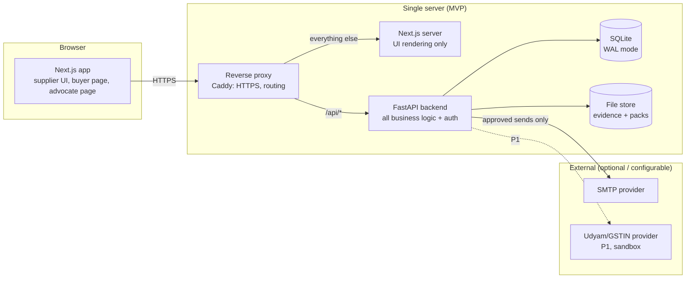
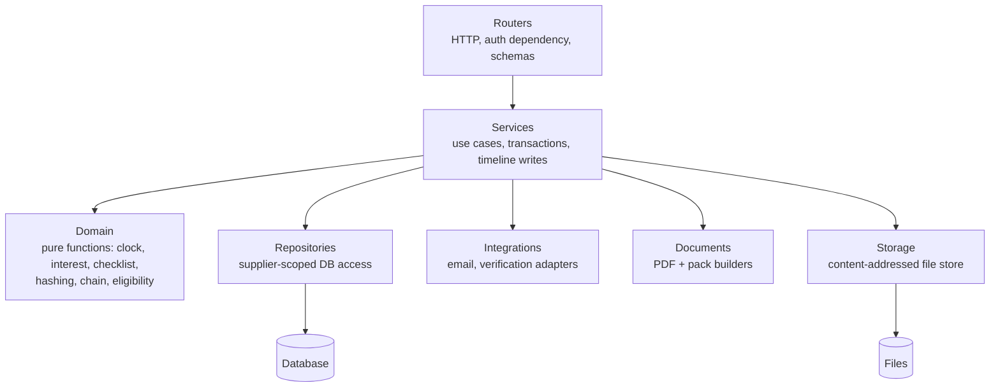
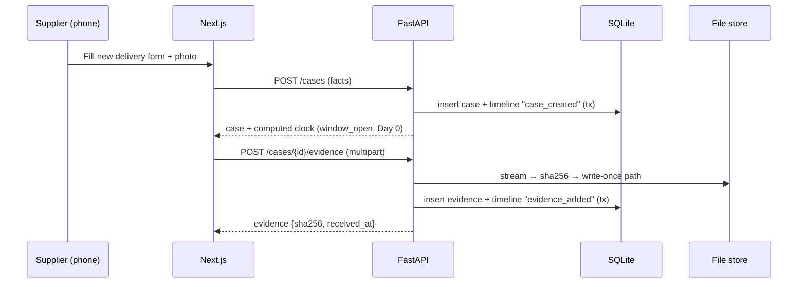
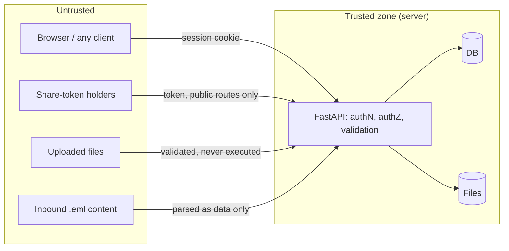

# PaySetu: Architecture

| Field | Value |
| --- | --- |
| Status | Draft v1.1 (consistency review), derived from PRD.md v1.1 and DESIGN.md v1.0. Decision IDs (ADR-xxx, LR-xx) refer to [DECISIONS.md](DECISIONS.md) |
| Principle | The simplest architecture that is correct, secure and honest about what is live |
| Scope | MVP (P0/P1). Future scalability is in [Section 15](#15-mvp-vs-future-scalability) |

---

## 1. Architecture at a Glance

PaySetu is **one web frontend + one backend API + one database + one local file store**, deployed on a single server behind a reverse proxy.



**Key decisions:**

1. **All business logic and authorisation live in the FastAPI backend.** The Next.js app is a presentation layer. It never talks to the database and holds no secrets.
2. **Same-origin deployment.** The proxy serves `/api/*` from FastAPI and everything else from Next.js, so cookies are first-party, CORS is not needed and CSRF exposure is small.
3. **Legal state is computed, not scheduled.** DeemedClock, interest and the checklist are pure functions of stored facts plus the current date. There are no cron jobs, queues or workers in the MVP.
4. **Evidence is append-only** on disk (content-addressed by SHA-256) and in the database (triggers block updates and deletes).
5. **Every external integration has a `simulated` adapter**, selected by configuration and labelled throughout the UI and outputs.

---

## 2. Recommended Tech Stack

| Layer | Choice | Reasoning |
| --- | --- | --- |
| Frontend framework | **Next.js (App Router) + React + TypeScript** | Owner-specified; file-based routing matches the PRD route list; good mobile performance |
| Styling | **Tailwind CSS** with design tokens from DESIGN.md mapped in the Tailwind theme | Owner-specified; tokens enforce the design system |
| Icons | Lucide React | Single outline set, as DESIGN.md requires |
| Frontend API types | `openapi-typescript` (dev dependency) generating types from the FastAPI OpenAPI schema | One source of truth for request and response shapes; no hand-written duplicate types |
| Backend framework | **Python 3.12 + FastAPI** | Owner-specified; matches the ideation prototype stack; Pydantic validation; automatic OpenAPI |
| Validation | Pydantic v2 + pydantic-settings | Request/response schemas and typed configuration |
| ORM / migrations | **SQLAlchemy 2.0 + Alembic** | Mature; the same code runs on SQLite (MVP) and PostgreSQL (future) |
| Database | **SQLite 3 (WAL mode)** in MVP; PostgreSQL later | Zero-ops for a single-server MVP; the upgrade path is documented |
| Password hashing | `argon2-cffi` (Argon2id) | Current recommended algorithm |
| PDF generation | **ReportLab** | Owner-specified; already used in the prototype; deterministic text PDFs |
| File packaging | Python standard library `zipfile`, `hashlib`, `tomllib` | No extra dependencies |
| Multipart uploads | `python-multipart` | Required by FastAPI for uploads |
| HTTP client | `httpx` | Provider calls (P1) and tests |
| DKIM (P1) | `dkimpy` | Mature DKIM verification library |
| Email sending | Python standard library `smtplib` behind an adapter | No vendor SDK lock-in |
| ASGI server | Uvicorn | Standard for FastAPI |
| Reverse proxy | Caddy | Automatic HTTPS, simple config |
| Backend quality | Ruff (lint + format), mypy (strict on `domain/`) | Fast and minimal |
| Frontend quality | ESLint (Next config), Prettier, `tsc --noEmit` | Standard |
| Tests | pytest + pytest-cov (backend; 100% branch-coverage gate on `app/domain`), Playwright (end-to-end) | Owner-specified; pytest-cov approved 25 Oct 2026 |
| Package managers | `pip` + `venv` with pinned `requirements*.txt`; `npm` with `package-lock.json` | Lowest tooling overhead |

**Deliberately not used in MVP:** Redis, Celery or any queue, Docker orchestration beyond an optional single compose file, an auth SaaS, an ORM on the frontend, a state-management library (React state + fetch is enough), form libraries, CSS-in-JS, analytics SDKs and any AI/LLM service.

---

## 3. Backend Architecture

### 3.1 Layers



| Layer | Responsibility | Must not |
| --- | --- | --- |
| `api/` routers | Parse/validate input (Pydantic), resolve the current principal, call one service method, map the result to a response schema | Contain business rules, or touch the ORM directly |
| `services/` | Orchestrate a use case inside one DB transaction; write the timeline events; call domain, repositories, storage, documents, integrations | Contain HTTP concepts |
| `domain/` | **Pure, deterministic** legal and integrity logic. Inputs are plain dataclasses; the date "today" is passed in | Do I/O, read the clock or the environment, or import SQLAlchemy/FastAPI |
| `repositories/` | All queries; **every query for supplier data takes `supplier_id` and filters by it** | Be bypassed by services |
| `integrations/` | Adapter interfaces + implementations (`smtp`, `simulated`; `cashfree_sandbox` P1) | Leak provider types to services |
| `documents/` | ReportLab templates, pack assembly, manifest | Decide legal outcomes (they receive computed values) |
| `storage/` | Write-once file store keyed by hash; read streams | Allow overwrite or delete through the app |

### 3.2 Domain modules (the core of the product)

| Module | Inputs → Outputs |
| --- | --- |
| `domain/rules.py` | Validates a decoded rule-set document → typed `RuleSet` (periods, multiplier, named reading policies, per-rule tier/source/effective date/verification status). No I/O: the TOML file is read by `app/rules/loader.py` |
| `domain/dates.py` | Month and year arithmetic on legal dates (month-end clamping; 29 Feb → 28 Feb per A11) |
| `domain/deemed_clock.py` | `CaseFacts` (delivery date, deal type, agreed terms, responses, objection removal) + `today` + `RuleSet` → `ClockResult` (acceptance state and basis, window end, acceptance date, due date, interest start, limitation date, explanations with rule IDs) |
| `domain/interest.py` | Principal (paise), interest start, payments, rate table, as-of date, `RuleSet` → `InterestResult` (period table, totals). Decimal only |
| `domain/checklist.py` | Supplier profile + case facts + evidence summary + communications + clock result + integrity status → list of `ChecklistItem` (C01–C17) |
| `domain/eligibility.py` | Supplier profile → eligibility verdict + reasons (R9, R9a, R10, R11) |
| `domain/integrity.py` | Canonical JSON serialisation, event hash, chain verification, file hash verification results |
| `domain/next_action.py` | Clock + checklist + communications + integrity → one next-action code (DESIGN.md 9.4) |

**The rule set is data.** `backend/app/rules/msmed-v1.toml` holds the periods and multiplier, the configurable assumptions A1–A8, and every rule ID from PRD Section 4 with its tier (S, I or C), explanation text and review status (`counsel_confirmed: false` until the matching LR item in DECISIONS.md is confirmed). Outputs that rely on an unconfirmed tier I or C rule carry a "pending legal review" label. A change to legal behaviour means a new file (`msmed-v2.toml`) and a version bump, never an in-place edit after release. Each case stores the rule-set version it was created under, and each output records the version used.

### 3.3 Product modules → code

The five PRD modules map onto the layers as follows. Module names in code comments, UI copy and docs must use the PRD names.

| PRD module | Domain (pure) | Services / documents | API | Frontend |
| --- | --- | --- | --- | --- |
| **DeemedClock** | `deemed_clock.py`, `interest.py`, `rules.py` | `services/cases.py`, `services/responses.py`, `services/payments.py`, `services/communications.py` (intimation) | `/cases`, `/responses`, `/payments`, `/communications` | `DayStrip`, `KeyDates`, `AmountSummary`, Responses, Payments and Letters tabs |
| **Evidence Vault** | `integrity.py` | `services/evidence.py`, `services/timeline.py`, `services/integrity.py`, `storage/` | `/evidence`, `/integrity-check`, `/timeline` | `EvidenceUploader`, `HashChip`, `Timeline`, Evidence tab |
| **Case Strength** | `checklist.py`, `eligibility.py`, `next_action.py` | (computed inside `services/cases.py`) | `/cases/{id}/checklist`, `/supplier` (eligibility) | `ChecklistItem`, `NextActionCard`, Checklist tab |
| **Buyer Cost Page** | `interest.py` (reused) | `services/share_links.py`, `services/communications.py` (demand) | `/share-links`, `/public/share/{token}` (buyer projection) | `/b/[token]`, Share tab |
| **Sealed Pack** | `integrity.py` (reused) | `documents/pack.py`, `services/packs.py`, `services/share_links.py` (advocate) | `/packs`, `/public/share/{token}` (advocate projection) | `/a/[token]`, Share tab |

### 3.4 Request lifecycle

1. The proxy terminates TLS and forwards to FastAPI with `X-Forwarded-*` headers.
2. Middleware assigns a `request_id`, enforces the body size limit, applies rate limits (Section 8.5), and checks Origin for unsafe methods.
3. The auth dependency resolves the principal: a `SupplierPrincipal` (session cookie) or a `SharePrincipal` (token in the URL path, for `/api/v1/public/*` only).
4. The router validates input → calls a service.
5. The service opens a transaction → repository reads/writes scoped by `supplier_id` → appends timeline events → commits.
6. Errors are mapped to the standard error format (API.md); logs are structured JSON with the `request_id`.

---

## 4. Frontend Architecture

### 4.1 Approach

- **Next.js App Router.** Route groups: `(public)` for the landing and auth pages, `(app)` for authenticated supplier pages, and `share` for the `/b/[token]` and `/a/[token]` pages.
- **Rendering:** authenticated app pages are client components that fetch from `/api/v1` with `credentials: "include"`. Public pages are simple server-rendered pages without user data. The share pages fetch on the client from the public API, so no token data is cached on the Next.js server.
- **Route protection:** Next.js middleware redirects to `/login` when no session cookie is present. This is **UX only**. Real authorisation is enforced by the API on every request.
- **Data access:** one typed API client (`src/lib/api/`) built on `fetch`, using generated OpenAPI types. It handles JSON, multipart uploads (with `XMLHttpRequest` for progress), the standard error format and 401 redirects. Components never call `fetch` directly.
- **State:** server state is fetched per page with a small `useApi` hook (loading/error/data/refetch). There is no global store. Form state is local React state.
- **Design system:** `src/components/ui/` implements DESIGN.md components (Button, inputs, StatusBadge, HashChip, DayStrip, …). Domain components (`src/components/cases/…`) compose them. Tailwind tokens are defined once in the Tailwind config from DESIGN.md Section 2–4.
- **Formatting:** all money, date and hash formatting goes through `src/lib/format/` (en-IN, Asia/Kolkata). Components never format inline.
- **Copy:** user-facing strings live in `src/content/` (one catalogue), ready for future Hindi.
- **No legal computation in the frontend.** The UI displays dates, amounts and checklist results returned by the API. The frontend never recomputes them.

### 4.2 Upload flow

1. The user picks or captures a file. The client checks type and size (UX only).
2. A multipart POST goes to `/api/v1/cases/{id}/evidence` with a progress bar.
3. The server streams to a temporary file while computing SHA-256, validates magic bytes and size, moves the file to the content-addressed path, inserts the row and a timeline event, and returns the hash.
4. The UI shows the `HashChip`. The client never computes or sends hashes that the server trusts.

---

## 5. Data Flow: Key Use Cases

### 5.1 Log delivery → clock



### 5.2 Approve and send a letter

1. `POST /communications` creates a draft from the template + computed values.
2. `PATCH` edits the draft (only while `draft`).
3. `POST /communications/{id}/approve` runs in one transaction: freeze the content, render the PDF, store it as evidence (type `communication_proof`), set `content_sha256`, add the timeline event `communication_approved`.
4. `POST /communications/{id}/send` with mode `email`:
   - Conditional update `approved|send_failed → sending` (prevents double send).
   - SMTP call with a 15 s timeout.
   - On success → `sent` + timeline `communication_sent`. On failure → `send_failed` + timeline `communication_send_failed`.
   - Mode `simulated` → `sent` with `delivery_mode=simulated`. Mode `manual` → `recorded_manual`.

### 5.3 Generate a Sealed Pack

1. Run integrity verification (files + chain). On failure, return 409 with the report.
2. Compute the clock, interest (as of the generation date) and checklist.
3. Render the PDFs (summary, timeline, s.63 draft, counsel questions, read-me).
4. Write the ZIP to a temporary path: evidence files are copied byte for byte, and `manifest.json` is written last.
5. Compute `manifest_sha256`, move the ZIP to `packs/{supplier_id}/{case_id}/v{n}.zip`, insert the `sealed_packs` row and the timeline event `pack_generated`, all in one transaction.
6. Generation runs synchronously within the request (target < 30 s). If real-world sizes exceed this, move it to a background task (Section 15).

### 5.4 Shared access (buyer/advocate)

1. Request `/api/v1/public/share/{token}`.
2. HMAC-SHA256 the token with `TOKEN_HASH_KEY` and look it up by hash.
3. Check purpose, `revoked_at` and `expires_at`.
4. Insert into the access log.
5. Return **only** the purpose-specific projection (buyer: the cost summary; advocate: the summary + timeline + evidence metadata + pack metadata).

---

## 6. Folder Structure

```
PaySetu/
├── README.md                     # Project overview + verified setup commands
├── AGENTS.md                     # Mandatory coding-agent rules (read first)
├── docs/                         # Detailed documentation
│   ├── PRD.md
│   ├── DECISIONS.md
│   ├── DESIGN.md
│   ├── ARCHITECTURE.md
│   ├── DATABASE.md
│   ├── API.md
│   └── IMPLEMENTATION_PLAN.md
├── frontend/
│   ├── package.json
│   ├── next.config.ts            # dev rewrite /api → backend
│   ├── playwright.config.ts      # e2e viewports 360×800 and 1280×800
│   │                             # Tailwind v4: DESIGN.md tokens live in src/app/globals.css (@theme); no tailwind.config file
│   ├── AGENTS.md                 # generated and maintained by `next dev` (Next.js agent notes); root AGENTS.md governs
│   ├── tsconfig.json             # strict
│   ├── .env.example
│   ├── public/
│   ├── src/
│   │   ├── app/
│   │   │   ├── (public)/         # /, /login, /signup, /legal/*
│   │   │   ├── (app)/            # /onboarding, /app/**
│   │   │   ├── b/[token]/        # Buyer Cost Page
│   │   │   ├── a/[token]/        # Advocate view
│   │   │   └── layout.tsx
│   │   ├── components/
│   │   │   ├── ui/               # design-system primitives
│   │   │   ├── layout/           # shells, nav, banners
│   │   │   ├── cases/ evidence/ communications/ share/ checklist/
│   │   ├── lib/
│   │   │   ├── api/              # typed client + generated types
│   │   │   ├── format/           # money, dates, hashes
│   │   │   └── hooks/
│   │   ├── content/              # UI copy catalogue
│   │   └── middleware.ts         # UX-only auth redirect
│   └── tests/e2e/                # Playwright
├── backend/
│   ├── requirements.txt
│   ├── requirements-dev.txt
│   ├── pyproject.toml            # ruff, mypy, pytest config only
│   ├── alembic.ini
│   ├── .env.example
│   ├── alembic/versions/
│   ├── app/
│   │   ├── main.py               # app factory, middleware, routers
│   │   ├── config.py             # pydantic-settings
│   │   ├── db.py                 # engine, session, SQLite pragmas
│   │   ├── security/             # passwords, sessions, tokens, csrf, rate limit
│   │   ├── api/v1/               # routers per resource
│   │   ├── schemas/              # Pydantic request/response models
│   │   ├── models/               # SQLAlchemy models
│   │   ├── repositories/
│   │   ├── services/
│   │   ├── domain/               # pure logic (see 3.2)
│   │   ├── rules/                # msmed-v1.toml
│   │   ├── documents/            # ReportLab templates, pack builder, fonts
│   │   ├── integrations/         # email/, verification/
│   │   ├── storage/
│   │   └── errors.py             # error types → problem responses
│   ├── seed/                     # bank_rates.toml, demo data script
│   └── tests/
│       ├── unit/                 # domain tests (no DB)
│       ├── integration/          # API + DB tests
│       └── fixtures/legal/       # counsel-reviewable rule fixtures (TOML)
├── deploy/
│   ├── Caddyfile
│   └── systemd/                  # unit files for api + web
├── storage/                      # gitignored runtime data (evidence/, packs/, tmp/)
├── Makefile                      # dev, test, lint, typecheck, migrate, seed
└── .gitignore
```

> `README.md` and `AGENTS.md` live at the root, where tools and agents look for them. Everything else lives in `docs/`. Coding agents must read `AGENTS.md` before any change.

---

## 7. Database Interaction

- **ORM:** SQLAlchemy 2.0 (typed `Mapped[...]` models), synchronous sessions. FastAPI runs sync endpoints in its threadpool, which is ample for MVP load and keeps the code simple.
- **Session per request**, with an explicit transaction per service method (`with session.begin():`). There are no implicit commits in routers.
- **SQLite settings** on connect: `journal_mode=WAL`, `foreign_keys=ON`, `busy_timeout=5000`, `synchronous=NORMAL`.
- **Migrations:** Alembic only. No `create_all` outside tests. Every migration is reviewed. Append-only triggers are created in migrations.
- **Ownership scoping:** repositories require `supplier_id` for all supplier data. A test asserts that every repository method touching supplier tables takes it (Section 12).
- **Money:** integer paise in the DB; `Decimal` in the domain; strings in the API (e.g. `"500000.00"`) to avoid float issues in JSON.
- **Time:** timestamps are stored as UTC ISO-8601; legal dates as `DATE` (no time zone), interpreted in Asia/Kolkata. The current legal date is computed as `now(Asia/Kolkata).date()`, obtained through a single injectable `Clock` provider. Tests freeze it.
- Details: DATABASE.md.

---

## 8. Authentication and Authorisation

### 8.1 Supplier authentication (MVP)

- Email + password ([PRD D2]). Argon2id hashing with library defaults; minimum length 10; check against a small bundled common-password list.
- On login, the server creates a random 256-bit session token, stores its **SHA-256 hash** in `sessions` and sets a cookie:
  - Name `ps_session`
  - Flags `HttpOnly`, `Secure` (production), `SameSite=Lax`, `Path=/`
  - Idle expiry 7 days (sliding, refreshed at most hourly)
  - Absolute expiry 30 days
- Logout revokes the session row. Changing the password revokes all other sessions.
- Login and signup errors are generic. There is no user enumeration.

### 8.2 CSRF

- `SameSite=Lax` cookies.
- For all unsafe methods, the API requires the `Origin` (or `Referer`) header to match `PUBLIC_BASE_URL`, and a custom header `X-PaySetu-Client: web`. A cross-site form cannot set custom headers.

### 8.3 Share-token access (buyer and advocate)

- Tokens are 32 random bytes, base64url-encoded, and shown once at creation.
- They are stored as `HMAC-SHA256(TOKEN_HASH_KEY, token)`.
- They are accepted only on `/api/v1/public/share/{token}/…` routes, and the principal is limited to one share link's purpose, case and pack.
- Responses are sent with `Cache-Control: no-store`, `Referrer-Policy: no-referrer` and `X-Robots-Tag: noindex`.

### 8.4 Authorisation model

| Principal | Allowed |
| --- | --- |
| `SupplierPrincipal(user_id, supplier_id)` | Only rows where `supplier_id` matches. Enforced in repositories; a missing match returns **404** (not 403) to avoid revealing existence |
| `SharePrincipal(link_id, purpose, case_id, pack_id?)` | Only the projection for that purpose and case |
| Operator | No HTTP access. Rate table and rule changes go through migrations or CLI scripts that record source and reviewer |

### 8.5 Rate limiting (in-process, single instance)

A simple in-memory sliding-window limiter, keyed by IP and/or user. It is acceptable because the MVP runs a single API process (Section 15 covers multi-instance).

| Scope | Limit |
| --- | --- |
| `POST /auth/login` | 5 / minute per IP+email; 20 / hour per IP |
| `POST /auth/signup` | 5 / hour per IP |
| Public share endpoints | 60 / minute per IP; 10 failed token lookups / minute per IP |
| Evidence upload | 30 / minute per user |
| Communication send | 10 / hour per user |
| Pack generation | 5 / hour per case |

---

## 9. API Architecture

- REST over JSON, versioned under `/api/v1`. Resource-oriented, with action sub-resources for state transitions (`/approve`, `/send`, `/revoke`).
- Every response schema is a Pydantic model; the OpenAPI document generates the frontend types.
- A standard error format (`application/problem+json`) with a stable `code` field.
- Cursor pagination on list endpoints.
- Full contract: API.md.

---

## 10. External Services

| Service | Adapter interface | Implementations (MVP) | Selection |
| --- | --- | --- | --- |
| Email sending | `EmailSender.send(message) -> SendResult` | `SmtpEmailSender`, `SimulatedEmailSender` (sends nothing; the communication row records `delivery_mode=simulated`) | `EMAIL_MODE=smtp\|simulated` |
| Udyam/GSTIN verification (P1) | `IdentityVerifier.verify_udyam(number) -> VerificationResult` | `SimulatedVerifier`, `CashfreeSandboxVerifier` | `VERIFICATION_MODE=off\|simulated\|sandbox` |
| DKIM (P1) | `verify_dkim(raw_bytes) -> DkimResult` | `dkimpy` (DNS lookup at verification time) | Always on when P1 is shipped |

Rules:

- Adapters return typed results with `mode` (`live`, `sandbox`, `simulated`). The mode is persisted with the outcome and shown in the UI and the pack.
- Timeouts: 15 s for SMTP; 10 s for verification. No automatic retry for email sends (retrying is a user action, to avoid duplicates). Verification GETs can be retried once.
- **Production gate** (implemented in `app/config.py`, T1.1): when `APP_ENV=production`, startup fails if any adapter is non-live (`simulated`, or `sandbox`, whose results are not real registry checks), unless `ALLOW_NONLIVE_VERIFIED=1` is set. If that override is used, the `SimulatedBanner` is shown to every user.

---

## 11. AI Architecture

**There is no AI or LLM component in the MVP.** This is deliberate:

- Legal dates and interest must be deterministic and auditable. They are rule-based by design.
- Tagging buyer replies is a manual supplier choice (PRD: Out of scope). This avoids misclassifying an objection, which would change legal dates.
- The checklist is rule-based, and outcome prediction is excluded.

Possible later use (Later, requires a new PRD decision): suggesting a reply tag for supplier confirmation, or extracting invoice fields from a photo. If added, it must stay advisory, be logged, and never write legal facts without supplier confirmation.

---

## 12. Environment Configuration

Configuration comes only from environment variables (loaded by `pydantic-settings` in the backend and Next.js env in the frontend). `.env.example` files list the names with placeholder values. Real `.env` files are gitignored.

| Variable | Where | Required | Purpose |
| --- | --- | --- | --- |
| `APP_ENV` | backend | yes | `development`, `test` or `production` |
| `PUBLIC_BASE_URL` | backend | yes | The **browser-facing** origin, used for links and the CSRF origin check (e.g. `https://paysetu.example`). In local development this is the Next.js origin (`http://localhost:3000`), not the API port, because requests are proxied |
| `DATABASE_URL` | backend | yes | e.g. `sqlite:///./storage/paysetu.db` |
| `STORAGE_DIR` | backend | yes | Root for `evidence/`, `packs/`, `tmp/` |
| `TOKEN_HASH_KEY` | backend | yes | 32+ random bytes for share-token HMAC |
| `SESSION_IDLE_HOURS` / `SESSION_ABSOLUTE_DAYS` | backend | no | Defaults 168 / 30 |
| `MAX_UPLOAD_MB` / `MAX_CASE_STORAGE_MB` | backend | no | Defaults 15 / 200 [PRD D11] |
| `EMAIL_MODE` | backend | yes | `smtp` or `simulated` |
| `SMTP_HOST`, `SMTP_PORT`, `SMTP_USERNAME`, `SMTP_PASSWORD`, `SMTP_STARTTLS`, `EMAIL_FROM` | backend | when `smtp` | Sending |
| `VERIFICATION_MODE` | backend | no | `off` (default), `simulated` or `sandbox` |
| `CASHFREE_CLIENT_ID`, `CASHFREE_CLIENT_SECRET`, `CASHFREE_BASE_URL` | backend | when `sandbox` | P1 |
| `ALLOW_NONLIVE_VERIFIED` | backend | no | `1` allows simulated adapters in production (shows a banner) |
| `LOG_LEVEL` | backend | no | Default `INFO` |
| `API_ORIGIN` | frontend (server only) | dev only | Target for the dev rewrite `/api → http://localhost:8000` |

Secrets are never prefixed `NEXT_PUBLIC_`. The frontend needs no secrets.

---

## 13. Error Handling

- **Domain errors** are typed exceptions (`NotFound`, `Conflict`, `ValidationFailed`, `IntegrityFailed`, `RateLimited`, `IntegrationFailed`) mapped centrally to HTTP status codes and problem responses. Routers do not catch and re-shape errors themselves.
- **Unexpected errors** return 500 with a generic message and the `request_id`. The full stack trace is logged server-side only.
- **Transactions:** a service method either commits fully (including its timeline events) or rolls back. File writes use temp-then-rename. An orphaned file without a DB row is harmless and can be swept up later; a row without a file must never happen (write the file first, then commit the row).
- **External failures** never lose user work. Approved communications persist, and the send status records the failure reason (sanitised).
- **Frontend:** the API client turns problem responses into typed errors. Pages show region-level `ErrorState`s; forms map `errors[]` to fields.
- **Logging:** structured JSON lines (timestamp, level, request_id, route, status, duration, principal type, supplier_id). Never log passwords, tokens, cookies, file contents, email bodies or full IPs (hash or truncate them).

---

## 14. Security Boundaries



| Boundary | Controls |
| --- | --- |
| Client → API | All input validated by Pydantic; authorisation in repositories; the client is never trusted for computed values, hashes, ownership or timestamps |
| Uploaded files | Type allowlist + magic-byte check; size limits; stored outside any web root under content-addressed names (user-supplied filenames never appear in paths); served only via authorised download with `Content-Disposition: attachment` and `X-Content-Type-Options: nosniff`; never rendered inline from the app origin; never executed or unpacked (no ZIP uploads) |
| `.eml` / chat text | Treated as bytes or plain text; HTML parts are never rendered in the app |
| Share tokens | Hashed at rest, scoped, expiring, revocable, rate-limited, logged |
| Secrets | Env vars only; never logged; never sent to the client |
| PDFs | Generated from escaped text (ReportLab paragraphs with escaped markup); no user-supplied HTML |
| Headers | Strict CSP (self only, no inline scripts beyond Next.js requirements via nonces), HSTS, `frame-ancestors 'none'`, `Referrer-Policy: strict-origin-when-cross-origin` (`no-referrer` on share pages) |
| Server | API and web processes run as an unprivileged user; storage directory permissions 0700; backups encrypted |

---

## 15. MVP vs Future Scalability

| Concern | MVP | When to change | Future |
| --- | --- | --- | --- |
| Database | SQLite (WAL), single file | More than one API instance, or write contention | PostgreSQL (same SQLAlchemy models; Alembic migrations re-run); add Row-Level Security as defence in depth |
| File storage | Local disk, content-addressed | Multi-server, or more than about 50 GB | S3-compatible object storage in an Indian region with Object Lock (WORM) |
| Rate limiting | In-memory | Multiple instances | Shared store (Redis) or proxy-level limits |
| Pack generation | Synchronous request | p95 > 20 s | Background task with status polling |
| Scheduled reminders | None (computed on read) | Reminder emails are approved as a feature | A single cron job calling an idempotent service |
| Auth | Email + password | OTP demand | Phone OTP via a DLT-registered SMS provider; optional TOTP |
| Multi-user | One user per supplier | CA channel validated | Organisation memberships + roles |
| Observability | Structured logs + uptime check | Production launch | Error tracking (self-hosted or a DPDP-compliant vendor), metrics |

---

## 16. Testing Approach

| Level | Tooling | What | Gate |
| --- | --- | --- | --- |
| Domain unit | pytest | Clock (every R-rule and boundary: Day 15/16, month ends, leap years, objection inside/outside the window, cap at 45 days), interest (reference fixture Rs 93,407; rate changes; part payments; partial months), checklist, eligibility, hashing and chain | 100% branch coverage on `domain/` |
| Legal fixtures | pytest, parametrised from `tests/fixtures/legal/*.toml` | Counsel-readable cases: inputs → expected dates and amounts | All pass; fixtures carry a `reviewed_by` field |
| Integration | pytest + FastAPI TestClient + temp SQLite + temp storage dir | Each endpoint: auth required, cross-supplier access → 404, validation, state transitions, append-only triggers, double-send prevention, token expiry/revocation | All pass |
| Security tests | pytest | CSRF header/origin enforcement, rate limits, upload rejection (wrong magic bytes, oversize), no secrets in responses or logs | All pass |
| End-to-end | Playwright (mobile 360×800 + desktop 1280×800) | Ravi journey J2–J8; tamper demo; buyer and advocate pages; revoked link | All pass on CI |
| Static | ruff, mypy, eslint, tsc, prettier --check | — | Zero errors |

Continuous integration (GitHub Actions, once the repository exists) runs: lint → typecheck → unit → integration → build → e2e.

---

## 17. Deployment Approach (MVP)

- **Target [PRD D1]:** one small Linux VM in an Indian region (e.g. 2 vCPU / 4 GB RAM / 80 GB disk).
- **Processes:** Caddy (ports 80/443) → `uvicorn app.main:create_app --factory` (one worker, localhost:8000) and `next start` (localhost:3000), managed by systemd.
- **Release:** pull the tagged release → install pinned dependencies → `alembic upgrade head` → `next build` → restart services → health check `GET /api/v1/health`.
- **Backups:** nightly SQLite online backup (`.backup`) + an rsync of `storage/evidence` and `storage/packs` to encrypted off-server storage; 30-day retention; a monthly restore test. Evidence files are immutable, so incremental copies are cheap.
- **Health:** `/api/v1/health` (process up, DB reachable, storage writable, adapter modes) plus an external uptime check.
- **Demo mode:** the same deployment with `EMAIL_MODE=simulated`, `ALLOW_NONLIVE_VERIFIED=1`, a seeded demo supplier and backdated cases. The `SimulatedBanner` is always visible.
