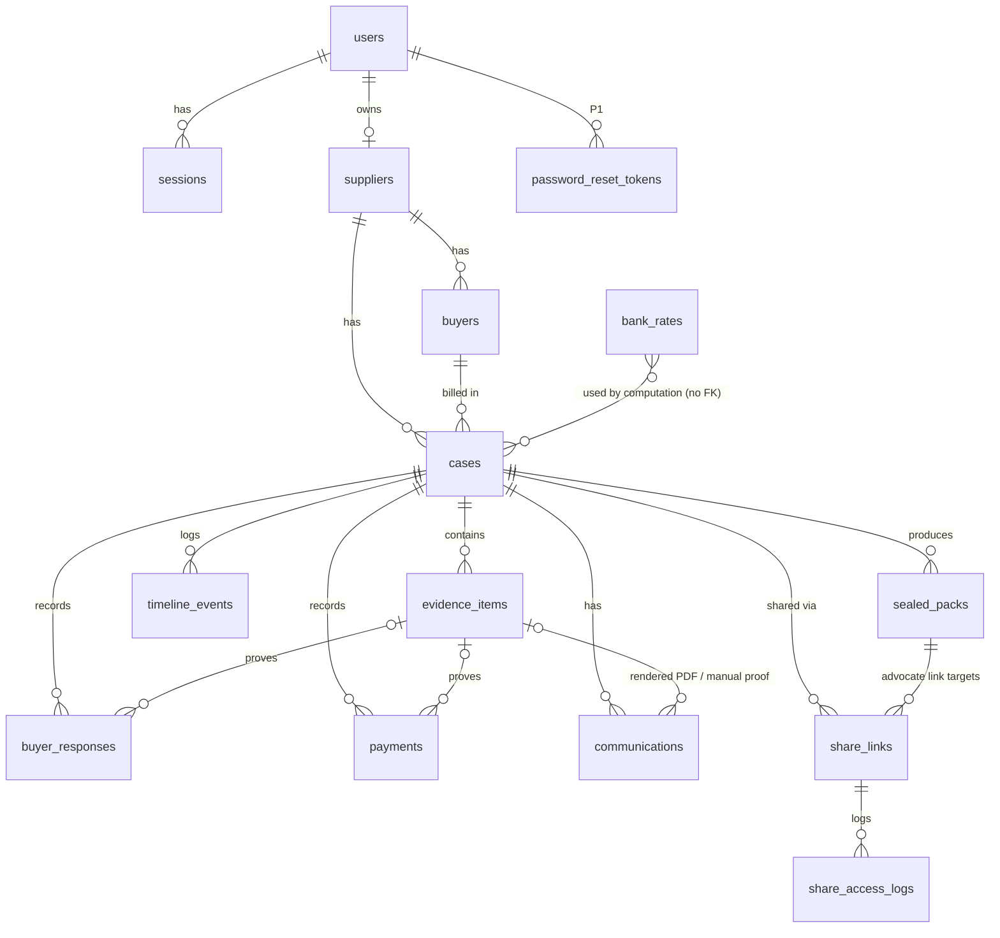

# PaySetu: Database Design

| Field | Value |
| --- | --- |
| Status | Draft v1.1 (consistency review), derived from PRD.md v1.1 and ARCHITECTURE.md v1.1 |
| Engine (MVP) | SQLite 3 (WAL mode) via SQLAlchemy 2.0 + Alembic |
| Engine (future) | PostgreSQL 16+ (same logical schema; notes inline) |

---

## 1. Principles

1. **Store facts, compute conclusions.** Acceptance state, due dates, interest, payment state, checklist and next action are **computed** from stored facts (PRD FR-CLK-03, FR-CHK-01). They are never stored as columns.
2. **Append-only where it matters.** `evidence_items`, `timeline_events`, `sealed_packs` and `share_access_logs` cannot be updated (except the defined exclusion fields) or deleted by the application. Database triggers enforce this.
3. **Tenant isolation by `supplier_id`.** Every supplier-owned row is reachable from exactly one supplier. Repositories always filter by it.
4. **Money in integer paise. Rates in basis points.** No floating point anywhere.
5. **Legal dates as `DATE`; events as UTC timestamps.**
6. **Only required data.** No speculative tables. P1 tables are marked.

### Type conventions

| Logical type | SQLite storage | PostgreSQL | Notes |
| --- | --- | --- | --- |
| `id` | `TEXT` (UUID v4, 36 chars) | `UUID` | Non-enumerable public IDs |
| `ts` | `TEXT` ISO-8601 UTC (`2026-11-01T09:02:11.123Z`) | `TIMESTAMPTZ` | Set by the server only |
| `date` | `TEXT` `YYYY-MM-DD` | `DATE` | Asia/Kolkata calendar date |
| `money` | `INTEGER` paise | `BIGINT` | `CHECK (>= 0)` |
| `bps` | `INTEGER` basis points (5.75% = 575) | `INTEGER` | |
| `enum` | `TEXT` + `CHECK (col IN (...))` | `TEXT` + `CHECK` (or native enum) | Values listed per table |
| `hash` | `TEXT` 64 lowercase hex | `CHAR(64)` | `CHECK (length = 64)` |
| `json` | `TEXT` (canonical JSON) | `JSONB` | Only where structure varies by event type |
| `bool` | `INTEGER` 0/1 + `CHECK` | `BOOLEAN` | |

Every mutable table has `created_at ts NOT NULL` and `updated_at ts NOT NULL`. Append-only tables have `created_at` only.

---

## 2. Entity Relationship Diagram

---

## 3. Tables

### 3.1 `users`

| Column | Type | Null | Constraints / notes |
| --- | --- | --- | --- |
| `id` | id | no | PK |
| `email` | TEXT | no | Stored lowercase-trimmed; `UNIQUE` |
| `password_hash` | TEXT | no | Argon2id encoded string |
| `full_name` | TEXT | no | 1–120 chars |
| `phone` | TEXT | yes | E.164 format when present |
| `terms_version` | TEXT | no | Version of Terms + Privacy Notice accepted |
| `terms_accepted_at` | ts | no | DPDP consent record |
| `is_active` | bool | no | Default 1; set to 0 on deletion request |
| `last_login_at` | ts | yes | |
| `deletion_requested_at` | ts | yes | P1 |
| `created_at`, `updated_at` | ts | no | |

### 3.2 `sessions`

| Column | Type | Null | Constraints / notes |
| --- | --- | --- | --- |
| `id` | id | no | PK |
| `user_id` | id | no | FK → `users.id` ON DELETE CASCADE |
| `token_hash` | hash | no | SHA-256 of the cookie token; `UNIQUE` |
| `created_at` | ts | no | |
| `last_seen_at` | ts | no | Sliding idle expiry |
| `expires_at` | ts | no | Absolute expiry |
| `revoked_at` | ts | yes | |
| `user_agent` | TEXT | yes | Truncated to 200 chars |
| `ip_hash` | hash | yes | HMAC of IP; never the raw IP |

### 3.3 `password_reset_tokens` (P1)

| Column | Type | Null | Constraints / notes |
| --- | --- | --- | --- |
| `id` | id | no | PK |
| `user_id` | id | no | FK → `users.id` ON DELETE CASCADE |
| `token_hash` | hash | no | `UNIQUE` |
| `expires_at` | ts | no | created + 30 min |
| `used_at` | ts | yes | Single use |
| `created_at` | ts | no | |

### 3.4 `suppliers`

| Column | Type | Null | Constraints / notes |
| --- | --- | --- | --- |
| `id` | id | no | PK |
| `owner_user_id` | id | no | FK → `users.id`; `UNIQUE` (one supplier per user in MVP, PRD D14) |
| `legal_name` | TEXT | no | 1–200 |
| `trade_name` | TEXT | yes | |
| `udyam_number` | TEXT | yes | Uppercase; `CHECK` pattern `UDYAM-[A-Z]{2}-[0-9]{2}-[0-9]{7}` (validated in the app as well) |
| `enterprise_class` | enum | yes | `micro`, `small`, `medium` |
| `major_activity` | enum | yes | `manufacturing`, `services`, `trading` |
| `udyam_registration_date` | date | yes | |
| `udyam_verification_status` | enum | no | `self_declared` (default), `certificate_uploaded`, `provider_verified_sandbox`, `provider_verified_live` |
| `udyam_verified_at` | ts | yes | |
| `gstin` | TEXT | yes | Uppercase, 15 chars, pattern-checked in the app |
| `address_line` | TEXT | yes | |
| `city` | TEXT | yes | |
| `state_code` | TEXT | yes | 2-letter state code |
| `pin_code` | TEXT | yes | `CHECK` 6 digits |
| `contact_email` | TEXT | no | Used as Reply-To |
| `contact_phone` | TEXT | yes | |
| `signatory_name` | TEXT | yes | Required before approving any communication (app rule) |
| `signatory_designation` | TEXT | yes | e.g. Proprietor, Partner, Director |
| `created_at`, `updated_at` | ts | no | |

Eligibility is computed (`domain/eligibility.py`), not stored.

### 3.5 `buyers`

| Column | Type | Null | Constraints / notes |
| --- | --- | --- | --- |
| `id` | id | no | PK |
| `supplier_id` | id | no | FK → `suppliers.id` |
| `legal_name` | TEXT | no | 1–200 |
| `gstin` | TEXT | yes | |
| `contact_name` | TEXT | yes | |
| `email` | TEXT | yes | Required by the app before an email send |
| `phone` | TEXT | yes | |
| `address` | TEXT | yes | |
| `archived_at` | ts | yes | Buyers with cases are archived, not deleted |
| `created_at`, `updated_at` | ts | no | |

Constraints: `UNIQUE (supplier_id, id)` (target for the composite FK below); `UNIQUE (supplier_id, gstin)` where `gstin IS NOT NULL` (a partial unique index).

### 3.6 `cases`

One invoice, one delivery (PRD FR-CLK-01).

| Column | Type | Null | Constraints / notes |
| --- | --- | --- | --- |
| `id` | id | no | PK |
| `supplier_id` | id | no | FK → `suppliers.id` |
| `buyer_id` | id | no | Composite FK `(supplier_id, buyer_id)` → `buyers(supplier_id, id)`, so a case cannot point at another supplier's buyer |
| `reference` | TEXT | no | `PS-YYYY-NNNN`, allocated per supplier per year inside the insert transaction; `UNIQUE (supplier_id, reference)` |
| `rule_set_version` | TEXT | no | e.g. `msmed-v1`; fixed at creation |
| `invoice_number` | TEXT | no | 1–60 |
| `invoice_date` | date | no | |
| `invoice_amount_paise` | money | no | `CHECK (> 0)` |
| `description` | TEXT | yes | Goods/services, ≤ 500 |
| `delivery_date` | date | no | The app rejects future dates (Asia/Kolkata). It may be before or after `invoice_date` |
| `delivery_location` | TEXT | yes | |
| `deal_type` | enum | no | `verbal`, `written` |
| `agreed_payment_days` | INTEGER | yes | `CHECK (agreed_payment_days BETWEEN 0 AND 365)`; only when `written` |
| `agreed_due_date` | date | yes | Only when `written`. `CHECK (deal_type = 'written' OR (agreed_payment_days IS NULL AND agreed_due_date IS NULL))`; at most one of the two is set |
| `lifecycle` | enum | no | `open` (default), `closed` |
| `closed_reason` | TEXT | yes | Required when `closed` (`CHECK`) |
| `closed_at` | ts | yes | |
| `created_by_user_id` | id | no | FK → `users.id` |
| `created_at`, `updated_at` | ts | no | |

Edit rule (app): invoice and delivery fields can be edited only until the first communication is approved. Every edit writes a `case_updated` timeline event containing the old and new values.

### 3.7 `buyer_responses`

| Column | Type | Null | Constraints / notes |
| --- | --- | --- | --- |
| `id` | id | no | PK |
| `case_id` | id | no | FK → `cases.id` |
| `kind` | enum | no | `objection`, `acknowledgement`, `other` |
| `received_on` | date | no | Must be ≥ `cases.delivery_date` (app rule) |
| `channel` | enum | no | `email`, `letter`, `whatsapp`, `in_person_written`, `phone_note`, `other` |
| `summary` | TEXT | no | 1–1000 |
| `evidence_item_id` | id | yes | FK → `evidence_items.id` |
| `objection_removed_on` | date | yes | Only for `kind = objection`; `CHECK (objection_removed_on IS NULL OR kind = 'objection')`; must be ≥ `received_on` (app) |
| `removal_evidence_item_id` | id | yes | FK → `evidence_items.id` |
| `created_at`, `updated_at` | ts | no | |

**Mutability:** a row is immutable except for setting `objection_removed_on` and `removal_evidence_item_id` once (app rule + trigger: these can change only from NULL). Corrections are made by recording a new response and noting the reason (timeline).

Whether a response is "within window" is computed (`received_on <= delivery_date + 15`, per PRD R4a), not stored. A `phone_note` objection is recorded but treated as **not written** by the clock. Every other channel, including `other`, counts as written (PRD R19, A6; LR-04) [COUNSEL]. Linked evidence items must belong to the same case (service rule).

### 3.8 `payments`

| Column | Type | Null | Constraints / notes |
| --- | --- | --- | --- |
| `id` | id | no | PK |
| `case_id` | id | no | FK → `cases.id` |
| `amount_paise` | money | no | `CHECK (> 0)` |
| `received_on` | date | no | ≥ `delivery_date` (app) |
| `mode` | enum | no | `bank_transfer`, `upi`, `cheque`, `cash`, `other` |
| `reference` | TEXT | yes | UTR or cheque number |
| `evidence_item_id` | id | yes | FK → `evidence_items.id` |
| `voided_at` | ts | yes | A payment entered by mistake is voided, never deleted |
| `void_reason` | TEXT | yes | Required with `voided_at` (`CHECK ((voided_at IS NULL) = (void_reason IS NULL))`); also recorded in the `payment_voided` timeline event |
| `created_at`, `updated_at` | ts | no | |

App rule: payments are allocated principal-first (PRD D4). If a new payment would take the total above the invoice amount, the API requires an explicit `confirm_exceeds_principal: true` flag. The excess is shown as "received towards interest".

### 3.9 `evidence_items` (append-only)

| Column | Type | Null | Constraints / notes |
| --- | --- | --- | --- |
| `id` | id | no | PK |
| `case_id` | id | yes | FK → `cases.id`. NULL only for supplier-level evidence (Udyam certificate) |
| `supplier_id` | id | no | FK → `suppliers.id`; must equal the case's supplier (app + the service only inserts via the case) |
| `kind` | enum | no | `invoice`, `delivery_challan`, `delivery_photo`, `purchase_order`, `written_terms`, `email`, `chat_export`, `tracking_record`, `udyam_certificate`, `buyer_response`, `payment_proof`, `communication_proof`, `other` |
| `original_filename` | TEXT | no | Sanitised for display only; never used in paths |
| `mime_type` | TEXT | no | From magic-byte detection, not the client header |
| `size_bytes` | INTEGER | no | `CHECK (> 0)` |
| `sha256` | hash | no | Of the exact stored bytes |
| `storage_key` | TEXT | no | `evidence/{supplier_id}/{sha256[0:2]}/{sha256}` |
| `received_at` | ts | no | Server time (authoritative) |
| `stated_captured_at` | ts | yes | Supplier-stated; labelled as such |
| `note` | TEXT | yes | ≤ 500 |
| `uploaded_by_user_id` | id | yes | NULL when system-generated (approved letter PDFs) |
| `source` | enum | no | `upload`, `system_generated` |
| `dkim_result` | enum | yes | P1: `pass`, `fail`, `none`, `error` (only for `.eml`) |
| `dkim_domain` | TEXT | yes | P1 |
| `excluded_at` | ts | yes | Set once |
| `excluded_reason` | TEXT | yes | Required with `excluded_at` (`CHECK`) |
| `created_at` | ts | no | |

Constraints: `UNIQUE (case_id, sha256)` (duplicate detection within a case), plus a partial unique index `(supplier_id, sha256) WHERE case_id IS NULL` for supplier-level evidence. Triggers: block `DELETE`; block `UPDATE` unless only `excluded_at` and `excluded_reason` change from NULL. The same file in two cases is stored once on disk (same `storage_key`) with two rows.

**Supplier-level evidence** (`case_id IS NULL`, e.g. the Udyam certificate) has no case timeline, so it creates no timeline event. Its hash is recorded on the row, and it is included in every Sealed Pack under `07_supplier_documents/` with its hash in the manifest. It does not count towards any case's storage quota.

### 3.10 `communications`

| Column | Type | Null | Constraints / notes |
| --- | --- | --- | --- |
| `id` | id | no | PK |
| `case_id` | id | no | FK → `cases.id` |
| `kind` | enum | no | `delivery_intimation`, `demand` |
| `template_version` | TEXT | no | e.g. `intimation-v1` |
| `status` | enum | no | `draft`, `approved`, `sending`, `sent`, `send_failed`, `recorded_manual` |
| `to_email` | TEXT | yes | Required for the email/simulated modes |
| `subject` | TEXT | no | |
| `body_text` | TEXT | no | Plain text; immutable after approval |
| `amounts_as_of` | date | yes | For a demand: the date the amounts were computed |
| `buyer_share_link_id` | id | yes | FK → `share_links.id` (a demand may embed the Buyer Cost link). **Added by migration 7** (`ALTER TABLE … ADD COLUMN`, nullable), because `share_links` does not exist when `communications` is created |
| `content_sha256` | hash | yes | Set on approval: hash of the canonical JSON {subject, body_text, to_email, kind, template_version} |
| `pdf_evidence_item_id` | id | yes | FK → `evidence_items.id`; set on approval |
| `approved_by_user_id` | id | yes | FK → `users.id` |
| `approved_at` | ts | yes | |
| `delivery_mode` | enum | yes | `email`, `simulated`, `manual` |
| `sent_at` | ts | yes | Server time of an `email`/`simulated` send, or the time a manual send was recorded |
| `manual_sent_on` | date | yes | For `recorded_manual` only: the supplier-stated date the letter was sent (API `sent_on`) |
| `provider_message_id` | TEXT | yes | |
| `manual_proof_evidence_item_id` | id | yes | FK → `evidence_items.id` |
| `last_error` | TEXT | yes | Sanitised, ≤ 500 |
| `send_attempts` | INTEGER | no | Default 0 |
| `created_at`, `updated_at` | ts | no | |

Constraints:

- `CHECK (status = 'draft' OR (approved_at IS NOT NULL AND content_sha256 IS NOT NULL))`
- `CHECK (status NOT IN ('sent','recorded_manual') OR sent_at IS NOT NULL)`

Trigger: once `approved_at` is set, `subject`, `body_text`, `to_email`, `kind` and `content_sha256` cannot change.

Transition guard (app): `UPDATE … SET status='sending' WHERE id=? AND status IN ('approved','send_failed')`. If the update touches 0 rows, the send is rejected with 409 (double-send protection).

### 3.11 `timeline_events` (append-only, hash-chained)

| Column | Type | Null | Constraints / notes |
| --- | --- | --- | --- |
| `id` | id | no | PK |
| `case_id` | id | no | FK → `cases.id` |
| `seq` | INTEGER | no | 1, 2, 3… per case; `UNIQUE (case_id, seq)` |
| `event_type` | enum | no | See the list below |
| `occurred_on` | date | yes | The legal/business date the event refers to (e.g. delivery date, response date) |
| `recorded_at` | ts | no | Server time |
| `actor_type` | enum | no | `supplier_user`, `system`, `advocate_link`, `buyer_link` |
| `actor_id` | id | yes | user id or share link id |
| `payload` | json | no | Canonical JSON (sorted keys, UTF-8, no insignificant whitespace); references entity IDs and hashes, never file contents |
| `prev_hash` | hash | no | `event_hash` of seq−1; 64 zeros for seq 1 |
| `event_hash` | hash | no | SHA-256 of the canonical JSON {case_id, seq, event_type, occurred_on, recorded_at, actor_type, actor_id, payload, prev_hash} |

**Event types:** `case_created`, `case_updated`, `case_closed`, `case_reopened`, `evidence_added`, `evidence_excluded`, `response_recorded`, `objection_removed`, `payment_recorded`, `payment_voided`, `communication_drafted`, `communication_approved`, `communication_sent`, `communication_send_failed`, `communication_recorded_manual`, `share_link_created`, `share_link_revoked`, `pack_generated`, `integrity_verified`, `integrity_failed`.

Supplier-level actions (profile edits, Udyam certificate upload, Udyam verification results in P1) are not case events. They are reflected in `suppliers` columns and in application logs.

Triggers: block `UPDATE` and `DELETE`. Sequence allocation: inside the service transaction, `seq = max(seq)+1` for the case. SQLite serialises writers, and PostgreSQL uses `SELECT … FOR UPDATE` on the case row. The `UNIQUE` constraint is the final guard.

Viewing a link (`share_access_logs`) does **not** create timeline events. This keeps the evidence chain free of high-volume noise.

### 3.12 `share_links`

| Column | Type | Null | Constraints / notes |
| --- | --- | --- | --- |
| `id` | id | no | PK |
| `case_id` | id | no | FK → `cases.id` |
| `purpose` | enum | no | `buyer_cost`, `advocate` |
| `sealed_pack_id` | id | yes | FK → `sealed_packs.id`; `CHECK (purpose <> 'advocate' OR sealed_pack_id IS NOT NULL)` |
| `token_hash` | hash | no | HMAC-SHA256 of the token; `UNIQUE` |
| `recipient_name` | TEXT | yes | Required for `advocate` (`CHECK`) |
| `recipient_email` | TEXT | yes | |
| `consent_text_version` | TEXT | yes | Required for `advocate` |
| `consent_given_at` | ts | yes | Required for `advocate` |
| `created_by_user_id` | id | no | FK → `users.id` |
| `expires_at` | ts | no | Advocate: ≤ created + 30 days (app); buyer: default +90 days |
| `revoked_at` | ts | yes | Set once |
| `created_at` | ts | no | |

### 3.13 `share_access_logs` (append-only)

| Column | Type | Null | Constraints / notes |
| --- | --- | --- | --- |
| `id` | id | no | PK |
| `share_link_id` | id | no | FK → `share_links.id` |
| `accessed_at` | ts | no | |
| `action` | enum | no | `view`, `download_pack`, `verify_integrity` |
| `ip_hash` | hash | yes | HMAC of IP with the server key |
| `user_agent` | TEXT | yes | Truncated to 200 |

Triggers: block `UPDATE` and `DELETE`.

### 3.14 `sealed_packs` (append-only)

| Column | Type | Null | Constraints / notes |
| --- | --- | --- | --- |
| `id` | id | no | PK |
| `case_id` | id | no | FK → `cases.id` |
| `version` | INTEGER | no | 1, 2, …; `UNIQUE (case_id, version)` |
| `manifest_sha256` | hash | no | Pack identifier |
| `storage_key` | TEXT | no | `packs/{supplier_id}/{case_id}/v{version}.zip` |
| `size_bytes` | INTEGER | no | |
| `timeline_head_seq` | INTEGER | no | Last event included |
| `timeline_head_hash` | hash | no | |
| `rule_set_version` | TEXT | no | |
| `bank_rate_table_version` | TEXT | no | e.g. a hash of the rate rows used |
| `amounts_as_of` | date | no | |
| `includes_simulated` | bool | no | |
| `checklist_snapshot` | json | no | Item IDs and statuses at generation (a historical record, not used for logic) |
| `created_by_user_id` | id | no | FK → `users.id` |
| `created_at` | ts | no | |

Triggers: block `UPDATE` and `DELETE`.

### 3.15 `bank_rates` (reference data, operator-managed)

| Column | Type | Null | Constraints / notes |
| --- | --- | --- | --- |
| `id` | id | no | PK |
| `effective_from` | date | no | `UNIQUE` |
| `rate_bps` | bps | no | `CHECK (rate_bps BETWEEN 1 AND 5000)` |
| `source_url` | TEXT | no | RBI press release or circular |
| `source_note` | TEXT | yes | |
| `verified_by` | TEXT | no | Name of the person who checked the source |
| `verified_at` | ts | no | |
| `created_at` | ts | no | |

Rows are added only by migration or seed scripts. There is no API write path. Rows are never edited: a mistake is corrected by a reviewed migration, and the table version hash changes. The seed includes the ideation document's figure (5.75% from 7 Oct 2026, previously 5.50%). The earlier history must be filled from RBI sources before real use.

---

## 4. Indexes (based on real queries)

| Query (from PRD/API) | Index |
| --- | --- |
| Login by email | `users(email)` UNIQUE |
| Session lookup on every request | `sessions(token_hash)` UNIQUE |
| Find the supplier for a user | `suppliers(owner_user_id)` UNIQUE |
| Buyer list / search by supplier | `buyers(supplier_id, legal_name)` |
| Case list by supplier, newest first; filter by buyer; filter open | `cases(supplier_id, lifecycle, delivery_date DESC)`; `cases(supplier_id, buyer_id)` |
| Case search by invoice number | `cases(supplier_id, invoice_number)` |
| Reference allocation | `cases(supplier_id, reference)` UNIQUE |
| Case detail children | `buyer_responses(case_id)`, `payments(case_id)`, `communications(case_id, created_at)`, `evidence_items(case_id, kind)`, `sealed_packs(case_id, version)` UNIQUE |
| Duplicate evidence check | `evidence_items(case_id, sha256)` UNIQUE |
| Timeline read and chain walk | `timeline_events(case_id, seq)` UNIQUE |
| Share token lookup | `share_links(token_hash)` UNIQUE |
| Share links for a case | `share_links(case_id, purpose)` |
| Access log for a link | `share_access_logs(share_link_id, accessed_at)` |
| Rate in force on a date | `bank_rates(effective_from)` UNIQUE |

The dashboard "needs attention" list is computed in the application over the supplier's open cases (expected well under 1,000 per supplier in MVP). No derived-date indexes are needed. Revisit if p95 > 300 ms.

---

## 5. Ownership and Authorisation

| Table | Owner path | Enforced by |
| --- | --- | --- |
| `suppliers` | `owner_user_id` | Repository: the principal's supplier is resolved from the session |
| `buyers`, `cases` | `supplier_id` | Every repository query includes `WHERE supplier_id = :principal_supplier_id` |
| `buyer_responses`, `payments`, `communications`, `timeline_events`, `sealed_packs`, `share_links` | via `case_id` → `cases.supplier_id` | Repository joins to `cases` with the supplier filter; services load the case first via a scoped query |
| `evidence_items` | `supplier_id` (and the case) | Scoped query; downloads re-check ownership |
| `share_access_logs` | via `share_links` → case | Readable by the owning supplier only |
| `bank_rates` | global reference | Read-only to the app |

A failed scope check returns "not found" to the caller. Integration tests create two suppliers and assert that every endpoint returns 404 for the other supplier's IDs.

### Row-level security

- **SQLite (MVP):** no RLS is available. Isolation is enforced in the repository layer (single choke point) and covered by tests.
- **PostgreSQL (future):** enable RLS on all supplier-owned tables as defence in depth. The app sets `SET LOCAL app.supplier_id = …` per transaction; policies apply `USING (supplier_id = current_setting('app.supplier_id')::uuid)` (child tables via `EXISTS` on `cases`). The app's DB role does not own the tables and has no `BYPASSRLS`.

---

## 6. Append-Only Enforcement (triggers)

Created in migrations. The SQLite form is shown; PostgreSQL uses equivalent `BEFORE UPDATE/DELETE` triggers that `RAISE EXCEPTION`.

| Table | Rule |
| --- | --- |
| `timeline_events`, `sealed_packs`, `share_access_logs` | `BEFORE UPDATE` and `BEFORE DELETE` → `RAISE(ABORT, 'append-only')` |
| `evidence_items` | `BEFORE DELETE` → abort. `BEFORE UPDATE` → abort unless `OLD.excluded_at IS NULL` and only `excluded_at`/`excluded_reason` change |
| `communications` | `BEFORE UPDATE` → abort if `OLD.approved_at IS NOT NULL` and any frozen column changes |
| `buyer_responses` | `BEFORE UPDATE` → abort if any column other than the removal fields changes, or if they were already set |
| `share_links` | `BEFORE UPDATE` → only `revoked_at` may change, and only from NULL |
| All of the above + `cases`, `payments` | `BEFORE DELETE` → abort (cases are closed; payments are voided) |

Account deletion (P1, D12) runs as an operator procedure that disables the triggers inside a controlled maintenance transaction, logs the action in an operator log file and removes the supplier's rows and files. It never runs through the normal API path.

---

## 7. Sensitive Data Handling

| Data | Classification | Handling |
| --- | --- | --- |
| Passwords | Secret | Argon2id hash only |
| Session, reset and share tokens | Secret | Stored as SHA-256 / HMAC only; the raw value is shown once (share links) or held only in a cookie |
| IP addresses | Personal | HMAC'ed with a server key before storage |
| User and buyer contact details (names, emails, phones) | Personal (DPDP) | Minimum necessary; shown only to the owning supplier; the Buyer Cost Page shows the supplier's contact details only |
| Evidence files (invoices, photos, chats, emails) | Confidential business + personal | Stored outside the web root, permissions 0700, served only after an authorisation check; photo EXIF kept (it is evidence) but the UI warns that it may contain location |
| Udyam / GSTIN numbers | Business identifiers | Normal confidentiality |
| Aadhaar | Not collected | — |
| Logs | Operational | No secrets, tokens, bodies or file contents; IP hashed |

**Encryption:** full-disk encryption on the server volume (provider default) plus encrypted backups. Column-level encryption is not used in MVP: the threat model (single-tenant server, scoped access) does not justify the key-management complexity. Revisit for production.

---

## 8. Migrations and Seed Strategy

- **Tool:** Alembic, with autogenerate as a starting point, always hand-reviewed. Triggers and partial indexes are written explicitly.
- **Naming:** `YYYYMMDD_HHMM_<short_description>.py`. One logical change per migration.
- **Forward-only in production.** Downgrades are written for development convenience but never run against production data.
- **Initial migration set (in order):**
  1. users, sessions
  2. suppliers, buyers
  3. cases
  4. evidence_items, timeline_events, plus the append-only triggers
  5. buyer_responses, payments
  6. communications, plus triggers (without `buyer_share_link_id`)
  7. sealed_packs, share_links, share_access_logs, plus triggers; then `ALTER TABLE communications ADD COLUMN buyer_share_link_id` (FK → share_links)
  8. bank_rates + seed rows
  9. (P1) password_reset_tokens; DKIM columns already present
- **Seeds:**
  - `seed/bank_rates.toml`: reference rates with source URLs and a verifier, loaded by migration 8. Mandatory in all environments.
  - `seed/demo.py` (development and demo only; refuses to run when `APP_ENV=production`): one demo user/supplier ("Ravi Fasteners", micro, manufacturing, sandbox-labelled data), two buyers, and three cases:
    - one with the window open (delivery 5 days ago)
    - one deemed-accepted and overdue (delivery 40 days ago, verbal)
    - one with an objection raised

    Demo evidence files are generated placeholder images and PDFs marked "SAMPLE".
- **Tests:** create a fresh SQLite file **per test** via `alembic upgrade head` (not `create_all`), so the triggers are tested too. Implemented in T1.2: fixtures `migrated_database_url` and `database` in `backend/tests/conftest.py`. Per-test isolation was chosen over per-session because migrations are fast; revisit if the suite slows down.
- **Infrastructure (T1.2):** `backend/alembic.ini` holds no database URL. `alembic/env.py` takes it from validated settings (`DATABASE_URL`) or an explicit test override, and runs SQLite migrations through `app.db.create_db_engine` with the application pragmas and `render_as_batch`. Constraint names follow the naming convention in `app/models/base.py`. The baseline revision `bf48eb38df15` is empty; migration 1 (users, sessions) chains from it.

---

## 9. Backup and Recovery

| Item | Approach |
| --- | --- |
| Database | Nightly `sqlite3 .backup` (safe while online in WAL mode) → compressed, encrypted, copied off-server |
| Evidence and packs | Nightly incremental sync of `storage/evidence` and `storage/packs`; files are immutable, so a file is copied only once |
| Retention | 30 daily copies + 12 monthly copies |
| Consistency | Back up the DB **before** the files. A DB row whose file is missing from the same night's backup is caught by the integrity check after restore. Because the service writes the file before the row, the file set is always a superset |
| Restore test | Monthly: restore into a scratch environment, run `alembic current`, run the integrity verification on all cases, and compare counts |
| RPO / RTO (MVP) | RPO ≤ 24 h; RTO ≤ 4 h (manual restore). Production targets are to be set before launch |
| Integrity as recovery check | After any restore, run the full chain + file hash verification. Any mismatch is a restore defect |

---

## 10. PostgreSQL Upgrade Notes (future)

- The type mapping is in Section 1. Use `UUID`, `TIMESTAMPTZ`, `DATE`, `BIGINT` and `JSONB`.
- Replace the SQLite triggers with PL/pgSQL equivalents. Enable RLS (Section 5).
- Use `SELECT … FOR UPDATE` on `cases` when allocating timeline `seq` and case references.
- Migrate data with a one-off script that re-verifies every timeline chain and file hash after the copy.
